# 城市微缩 · City Diorama

把一座城市做成可以拿在手里转的微缩模型。

纯程序化生成的三渲二（cel-shading）三维场景，**没有一张外部贴图、没有一个外部模型文件** —— 建筑、瓦片、窗、招牌、水面、砖路全部在运行时用代码和 canvas 画出来。构建产物是单个 HTML，双击就能看，不需要服务器、不需要网络。

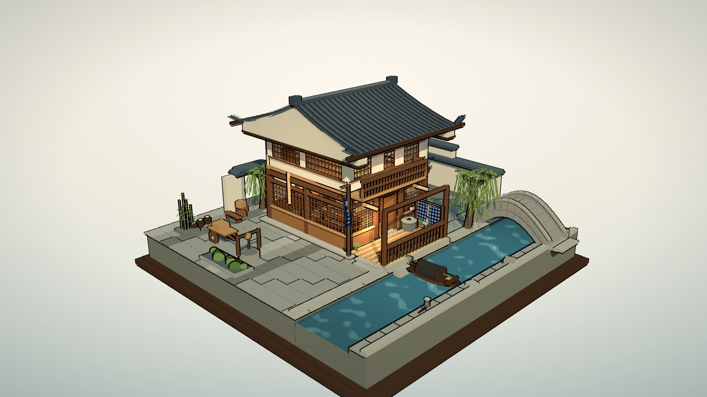

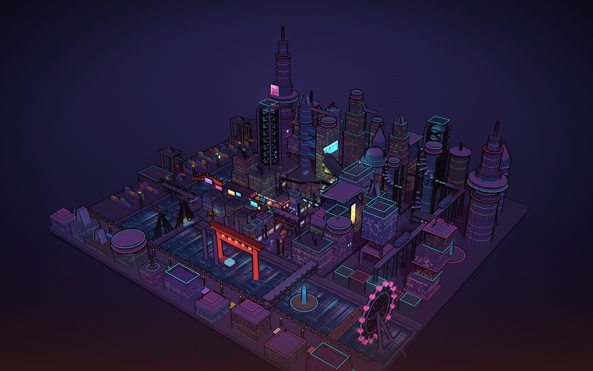

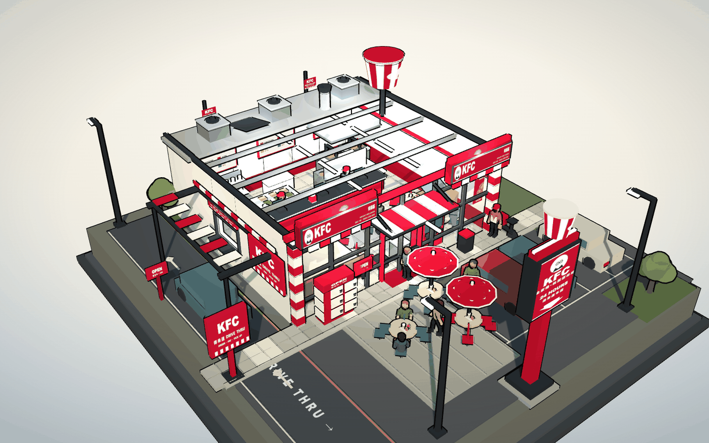

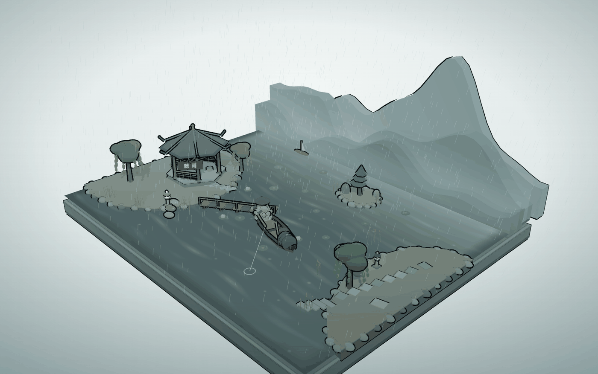

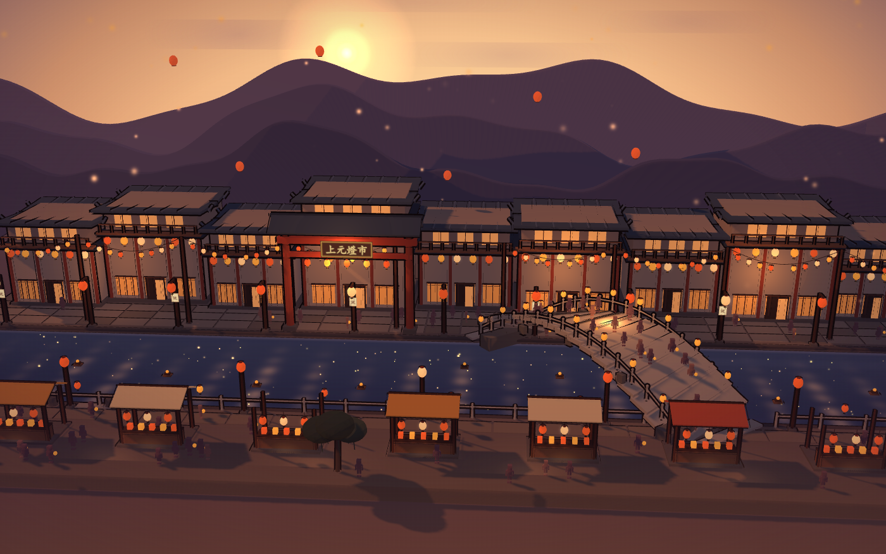

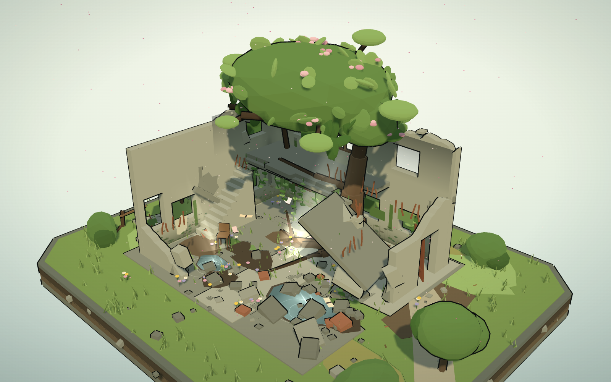

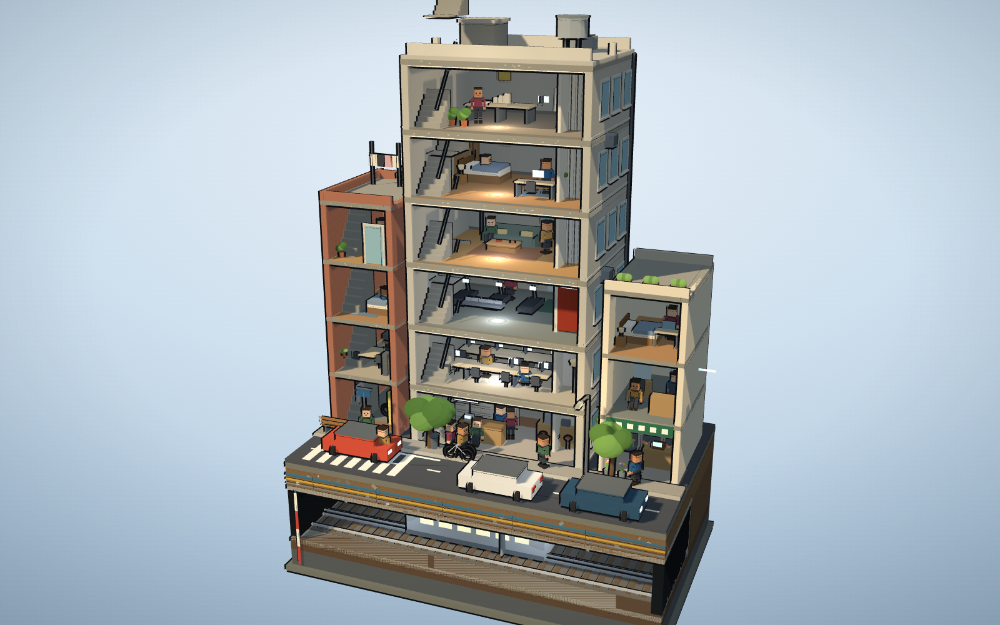

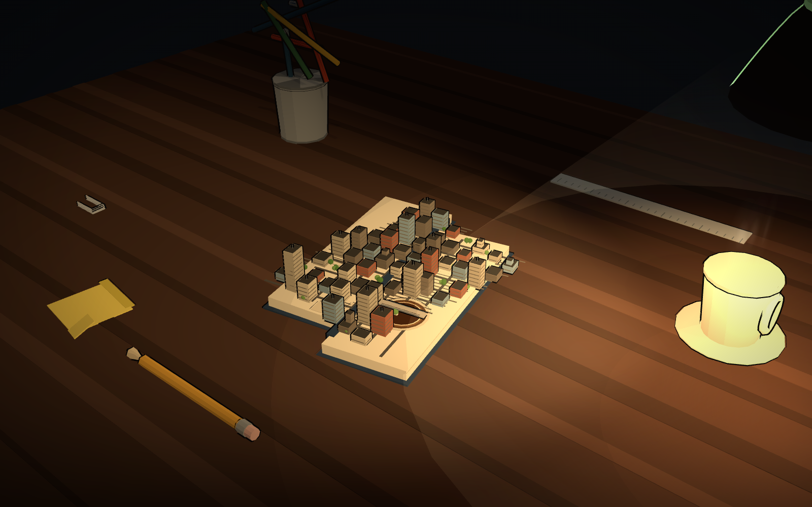

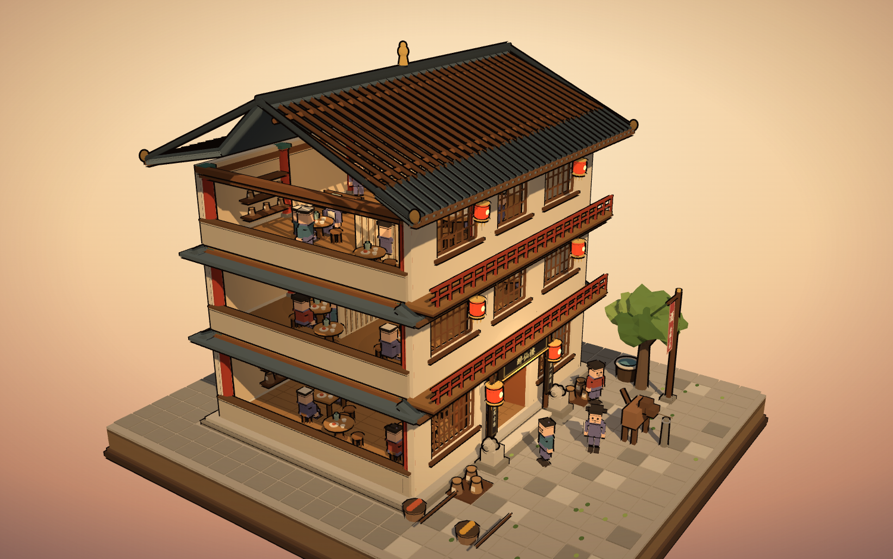

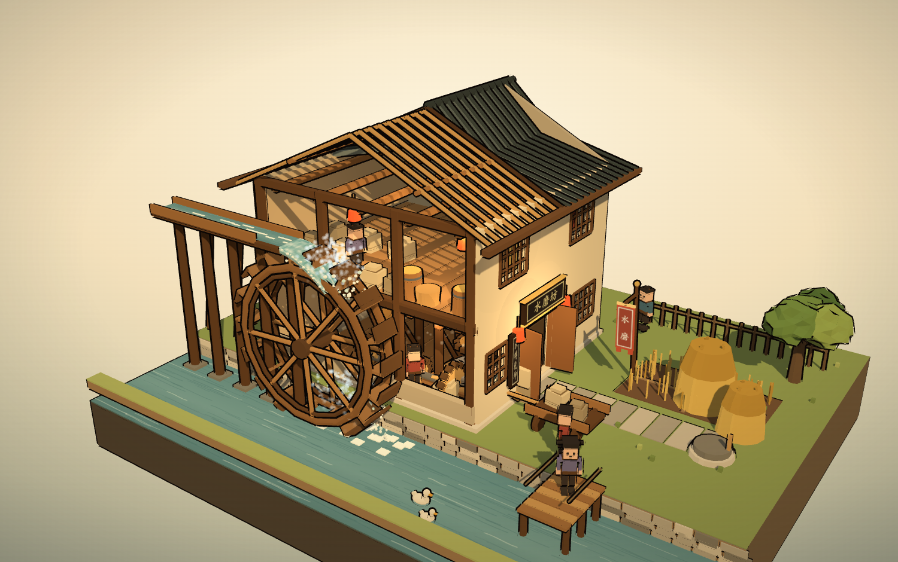

## 在线体验

构建产物已放在 `docs/`，开启 GitHub Pages 后可直接在浏览器里拖拽：

> 旗舰城市：`https://marvelous-dot.github.io/city-diorama/`
>
> 肯德基得来速店：`https://marvelous-dot.github.io/city-diorama/kfc.html`
>
> 寒江雪 · 孤舟独钓：`https://marvelous-dot.github.io/city-diorama/rainlake.html`
>
> 千灯 · 上元灯会：`https://marvelous-dot.github.io/city-diorama/lantern.html`
>
> 废墟 · 春回：`https://marvelous-dot.github.io/city-diorama/ruin.html`
>
> 城市剖面：`https://marvelous-dot.github.io/city-diorama/section.html`
>
> 桌面上的世界：`https://marvelous-dot.github.io/city-diorama/desk.html`
>
> 醉仙楼 · 三层酒肆：`https://marvelous-dot.github.io/city-diorama/tavern.html`
>
> 水车磨坊 · 溪畔：`https://marvelous-dot.github.io/city-diorama/mill.html`
>
> 总览（15 个在线演示）：`https://marvelous-dot.github.io/city-diorama/gallery.html`
>
> 苏州园林 · 一池三山：`https://marvelous-dot.github.io/city-diorama/garden.html`
>
> 福建土楼 · 承启楼：`https://marvelous-dot.github.io/city-diorama/tulou.html`
>
> 丽江古城 · 四方街：`https://marvelous-dot.github.io/city-diorama/lijiang.html`
>
> 悬空寺 · 恒山：`https://marvelous-dot.github.io/city-diorama/xuankong.html`
>
> 敦煌莫高窟：`https://marvelous-dot.github.io/city-diorama/mogao.html`
>
> 欢乐游乐园：`https://marvelous-dot.github.io/city-diorama/park.html`

## 预设

| id | 名称 | 类型 | 说明 |
|---|---|---|---|
| `city` | 霓虹 · 日本街 | 夜景 / 动态 | 134×124 米的赛博城市：六街区老城 + 外环 L 形水系、六座桥、集装箱港、水上摩天轮、高架单轨 |
| `cyber` | 霓虹 · 日式横丁 | 夜景 | 单条小巷，灯笼与居酒屋 |
| `jiangnan` | 江南 · 临水茶楼 | 日景 | 二层茶楼、拱桥、乌篷船 |
| `huizhou` | 徽州 · 马头墙茶栈 | 日景 | 粉墙黛瓦、马头墙 |
| `chuanxi` | 川西 · 锦江茶铺 | 日景 | 竹椅盖碗、沿街茶摊 |
| `tengwang` | 滕王阁 · 落霞孤鹜 | 日景 | 重檐楼阁与水面倒影 |
| `jiaodong` | 胶东 · 海草房农家院 | 日景 | 厚海草屋顶、石墙院 |
| `store` | 拾光便利 · 午后 | 日景 | 街角便利店，室内可见 |
| `club` | 山海仓 · 会员大卖场 | 日景 | 仓储式卖场的货架纵深 |
| `wh` | 恒仓 · 自动化工厂仓库 | 日景 | 高位货架、输送线、AGV |
| `kfc` | 肯德基 · 得来速店 | 日景 / 室内外 | 剖开屋顶的快餐店：点餐台、后厨炸炉、卡座、儿童区 + 得来速车道、立柱全家桶、户外桌椅；乐高积木人店员顾客 + 3 件 NVIDIA SimReady 开源资产 |
| `lantern` | 千灯 · 上元灯会 | 黄昏 / 灯会 / 动态 | 68×42 米暮色河湾：三层靛紫远山与落日、九栋错落临水灯阁、「上元燈市」牌楼、斜跨石拱桥与桥上人潮、近岸九座灯市摊；192 盏花灯辉光呼吸 + 河灯顺流 + 孔明灯升空 |
| `rainlake` | 寒江雪 · 孤舟独钓 | 雪景 / 留白 | 柳宗元《江雪》：116×92 米寒江向雪雾渐隐、四层递远群山、峰顶薄雪、GPU 斜风飘雪、近景一叶孤舟与蓑笠翁 |
| `ruin` | 废墟 · 春回 | 日景 / 叙事 | 20×16 米切开的土台上一栋半塌的两层水泥小屋：断墙、断掉的室内楼梯、烟囱、斜插的楼板；一棵树从二层缺口里长出来，藤蔓垂落、野花与落叶铺满、积水映天光，花瓣与尘埃在光柱里飘 |
| `section` | 城市剖面 | 日景 / 剖面 | 19×12 米地被竖直切开：6 层混合用途楼（便利店 / 联合办公 / 健身 / 公寓 / 卧室 / 工作室）、左邻砖砌四层小楼、右邻三层花店与理发店；切面之下是街道、地下土层层理、管线与一列亮着窗的地铁 |
| `desk` | 桌面上的世界 | 夜景 / 微缩 | 深夜书桌，一盏台灯只照亮一隅：光圈里一本摊开的书，书页上长着一座城——咖啡渍是湖、回形针是环线、笔筒里的笔是摩天楼。全场唯一光源是灯罩里的聚光灯 |
| `tavern` | 醉仙楼 · 三层酒肆 | 黄昏 / 室内外剖切 | 三层酒楼，门窗是真洞口、右山墙整面剖开、屋顶掀掉前坡：一层大堂（柜台/酒坛/八仙桌/店小二）、二层雅座（屏风/圆席）、三层雅阁（书案/博古架/琴案）从门、窗、剖面三个方向都看得见；三层进深前后都铺满席位并各自补光，不留空半层；「醉仙樓」匾额、楹联、酒旗、宫灯、石狮与门前酒坛堆；人物是可切风格的体素 / 乐高积木小人 |
| `mill` | 水车磨坊 · 溪畔 | 日景 / 可动机械 | 22×18 米切角土台，上击式水车真转：高架引水槽把水送到轮顶偏上游，轮轴穿墙进屋 → 长轴换向 → 竖轴带石磨，三个独立 Group 由同一个 `t` 联动；`+Z` 山墙整面剖开、屋顶靠剖口那半掀掉只留椽檩，一层磨盘齿轮与二层粮仓都看得见；滚动水面贴图、槽内活水、抛物线连续水舌冲进轮斗、冲击飞溅、轮底浪花、面粉尘、麦田麦垛、板车旗幡与积木人 |
| `garden` | 苏州园林 · 一池三山 | 日景 / 大型园林 | 68×52 米大宅园：西花园 + 主园 + 东宅四进 + 东路花厅/书房 + 北后园 + 南前庭 + 果园，主池居中、远香堂面水、池中六角亭、二层见山楼、扇亭、石舫、曲廊、小飞虹廊桥、南岸太湖石假山、东西小院与月洞门；粉墙黛瓦、花街铺地、竹柳梅荷 |
| `tulou` | 福建土楼 · 承启楼 | 日景 / 圆形巨构 | 外径 30.4 米、墙厚 1.5、四层 36 开间环廊、环形双坡瓦顶、内院祠堂与水井、门前半月池、旗杆石与竹林菜地 |
| `lijiang` | 丽江古城 · 四方街 | 日景 / 河街街区 | 56×44 米：玉河贯南、三座石桥、四方街与骑楼店铺、木府三进与牌坊、两岸三坊一照壁民居、双水车与垂柳 |
| `xuankong` | 悬空寺 · 恒山 | 日景 / 崖壁贴壁 | 56×40 米：崖壁（中间平壁贴楼阁 + 两侧低模岩山 + 山脊）、三层楼阁悬挑、栈道与斜撑、谷底石渠与山门 |
| `mogao` | 敦煌莫高窟 | 日景 / 崖壁洞窟 | 60×40 米：砾岩崖壁、三层窟门阵列（拱券 + 壁画色块）、九层楼、三层之字栈道（楼前断开绕行）、塔林五座、宕泉河 |
| `park` | 欢乐游乐园 | 黄昏 / **全动** | 64×44 米：摩天轮（转 + 座舱竖直）、过山车（闭合轨道 + 3 节车厢）、旋转木马、海盗船、飞椅、小火车 |

## 快速开始

只需要 Node.js，**没有任何 npm 依赖**（three.js 已内联在 `src/`）。

```bash
node build.js            # 构建全部预设
node build.js city       # 只构建某一个
node build.js city store # 构建指定的几个
```

产物输出到 `dist/`，每个都是独立的单文件 HTML。

## 交互

| 操作 | 效果 |
|---|---|
| 左键拖拽 | 环绕旋转 |
| 滚轮 | 缩放 |
| 右键拖拽 | 平移 |
| 松手静置 | 缓慢自动环绕 |

移动端单指旋转、双指缩放。相机按竖屏做了自适应拉远，手机上不会切掉边角。

## 技术要点

### 三渲二

`MeshToonMaterial` + 自定义 4 段渐变贴图（0.40 / 0.66 / 0.85 / 1.0）压出硬边明暗。

描边不是后期做，是**反向外壳**：同一份几何沿法线外推 `0.0017`，用 `BackSide` 渲染，加进同一个合批里。比后处理描边稳，也不会在细杆件上断线。

### 合批：1585 个 mesh 的城市只有几十个 draw call

所有静态几何都进 `Builder`：`box / cyl / sph / torus / add / xf`，按材质 key 分桶，最后每个桶合并成一个 `BufferGeometry`。

代价是**合并之后动不了** —— 所以天桥上的车、街上的行人必须各自成 `Group`，走独立的动画轨道。这条约束决定了整个场景的组织方式：静态的尽可能合，动态的尽可能少。

### 贴图全部现画

招牌墙、砖墙、窗格、路面、水面波纹都是 `canvas` 画完当贴图用。招牌墙是一张 300×200 的 canvas 画 6 条竖招牌，`RepeatWrapping` 平铺，十几米的招牌密度只花一个 mesh。

远景的假字是随机横竖笔画拼出的「字形」——远处只认黑块与留白的比例，真字反而会因为重复在近景露馅。但**品牌形制必须用真字**：KFC 的招牌、菜单、得来速地面字全用 `canvas` 的 `fillText` 画，否则一眼就认不出是哪家店。

### 发光

`MeshBasicMaterial` + `AdditiveBlending` + `depthWrite: false` + **`fog: false`**。

最后那个 `fog: false` 是关键：夜景有一层紫雾把远景压进背景，但霓虹不能被雾吃掉，否则整个城市会灰掉。

### 天际线：一栋一原型

`ctTower` 只会画方盒加等比例退台，全城共用就会变成一排方形立柱。旗舰预设里并列了八种独立原型（`ctArt*`）：收分八棱塔、外露钢骨架塔、圆柱塔、双塔连体、错层悬挑、镂空门洞、螺旋坡道、楔形斜切；剩下保留方盒的楼再各配一种塔冠（金字塔 / 圆冠 / 飞碟 / 刀片 / 立环 / 针尖 / 开敞框架）。

圆柱与棱柱不能贴四面窗格贴图，改用一圈圈薄发光环加竖棱；环带密度是成败关键，太密就读成一根螺纹管。这些新几何依然全部进 `Builder` 合批，只多出几个材质桶。

### 外环扩展：水面低一层，桥要能透下去

老城 64×60 米，外环铺到 134×124 米，**老城坐标一个不动** —— 等比放大整座城只会变空，正确做法是外围填等量的新内容。

关键的三条几何约束：

- **水面比路面低 1.05 米**：外圈底座顶在 `-1.80`，所有陆地垫到 `y=0`，老城与新区就成了浮在水上的台地，台地侧面天然是驳岸，不用另挖洞。
- **跨水的桥不能有不透明顶板**：第一版在南湖上放了一座玻璃天桥，俯视时它的实心顶板把 18 米宽的水面切成一条紫带，整片水读成棋盘格。改成开敞桁架桥后水才连起来。
- **桥要分高低**：拱桥 0.85 / 太鼓桥 0.7 / 轻轨桥 5.4 / 斜拉桥 1.1 / 桁架桥 2.6 / 浮桥 -0.6，六座同高会叠成一块板。

水面是一张 `canvas` 波纹贴图 + 一张霓虹倒影贴图加色叠上去，几百条细波纹全部合批成一个 mesh。摩天轮的轮圈、列车、驳船各自成 `Group` 才能转 / 才能动。

### 让城市动起来

「有车在跑」的视觉信号不是车的形，是**移动的光** —— 每辆车前面拖一片加色混合的地面光斑，比车本身有效十倍。1.5 米高的行人做腿部动画会让 mesh 数翻倍，收益为零；整体上下浮动加侧倾就足够读成「在走」。

### 剖开屋顶：室内外都要看见

`kfc` 是一套独立形制（`buildKfcSite / Shell / Interior / Props`），不在 `store` 上改。它要解决的是「室内外元素齐全」这个和城市完全不同的问题：

- **屋顶前半剖开、后半保留设备平台**：俯视时点餐台、菜单屏、后厨炸炉、卡座、儿童区全部露出来，同时屋顶的空调外机、排烟管还在，建筑不会读成一个没盖的盒子。
- **任何横跨室内的横条，俯视都会把室内切成条**：第一版沿 x 的红色长檐框、连续招牌带、条纹雨棚把室内切得七零八落。解法是拆段、退到立面外侧、压低高度、改深色细边（`0.14` 米），中间留 4.2 米通透。
- **贴片和背板必须同向**：侧墙招牌贴片 `ry=0` 时宽度沿 x，背板若写成沿 z 铺，就会露出一大块没贴图的纯红板。`kfPlane` 默认单面，相机看不到背面要显式开 `DoubleSide`。
- **地面字要放在雨棚投影之外**：`DRIVE THRU` 被雨棚条板盖住后，把字从 `x=-3.20` 挪到 `x=5.30`，条板从 9 片减到 6 片并加大间隙。
- **立柱招牌别挡自己的字**：顶部旋转全家桶半径从 `0.82` 收到 `0.50`，贴片从 `±0.14` 挪到 `±0.30`、背板加厚到 `0.56`，否则柱子会从牌面中间穿过吃掉一个字母。
- **共享装饰守卫要逐个补 `&& !KFC`**：灯笼、柳树、石灯之类是民居共用的，新形制不排除会飘在快餐店停车场上。

最终 223 个 mesh / 46980 三角，全部材质键在预设里齐备，无缺色告警。


### 寒江雪：主角是空，不是房子

`rainlake` 是第 12 套、也是第一套没有主体建筑的形制。它按柳宗元《江雪》整体重做过一次：
上一版 26×22 米的「江南烟雨盆景」塞了凉亭、栈桥、柳荷石灯，人踪太多、船太小，
读不出「千山鸟飞绝，万径人踪灭」。现在 116×92 米江面向四周渐隐进雪雾、不留托盘边界，
群山四层递远、只有主峰顶着一撮雪，人踪只剩雾里两株枯枝，一叶孤舟是全画面唯一浓墨。

六条实测经验：

- **相机方位角决定构图生死**。`position.x = d·sin(phi)·cos(theta)`，`theta=0` 是站在 +x 侧看，
  横贯 ±66 米的群山会被拧成画面右侧一条斜带、江面变成一整块白板。正对 -z 群山要
  `theta≈1.50`；配 `phi≈1.32` 的近水平俯角，才是「远山横贯上缘 / 寒江占下半 / 孤舟偏左」的立轴三段式。
- **雪帽只能给主峰，不能沿脊线铺带**。连续白带叠三层就是「等高线面条」，被前层山切断后
  还会剩下一片片白色斜胶带。最终做法是扫描局部极大值、要求明显高出两侧，每峰只盖一个纺锤形小雪帽。
- **山脚那条过曝白线是两件事叠出来的**：远岸白色雪坡顶面 + 雪雾片最浓区正好压在 `y≈0`。
  把岸沉到与水面齐平并改暗灰、雾的浓区抬到山脚上方、江面远侧混雾系数压到 `0.26`，硬线才化成山入水。
  画面左侧那片挥之不去的白色斜碎片最后查明是远处小亭的雪顶被雾切剩一角，不是雪帽 —— 删亭即消失。
- **坐姿人物在俯视下就是一坨圆盘**。蓑笠翁不画脸不画肤色，靠「宽斗笠 → 一整片驼背 →
  带稻草束的蓑衣 → 一条垂出船舷的腿 → 一根前伸握竿的手臂」建立剪影；两个对称肩球会变成
  「一张有耳朵的脸」，必须合并成背。人高 / 船长 ≈ 27%，再把船放到近景 `z=+15` 靠透视放大，
  而不是把整条江缩小。蓑衣的稻草束 `z` 要落在锥台表面外侧，贴着中轴画会整根埋进几何里。
- **雪要在 shader 里，不要逐帧对象**。900 片雪存进一个 `T.Points`，
  `mod(aBase - uTime*uSpd, uH)` 循环下落 + 斜风横移，尺寸按 `aSize*860/d` 拉开 5 倍；
  均匀圆点阵会像屏幕噪点，不像风雪。
- **「寒」不是把灯调暗**。主光冷白 `0.88`、半球光 `1.26`、饱和度压到青灰，全画面只留蓑衣一点暖褐；
  不设任何点光，暖光会毁掉寒意。

最终 24 个 mesh / 4880 三角，`magenta:[] / errors:[]`。

### 上元灯会：主角是灯，不是房子

`lantern` 是第 13 套，也是第一套「极闹」的形制。它与 `rainlake` 刻意做成两端：
那边是寒江留白、一点浓墨；这边是 68×42 米河湾里满铺的万点暖光。
暮色远山与落日在天，临水灯街在中，寒河与河灯在下，一座斜跨石拱桥把两岸连起来。

六条实测经验：

- **灯火不能靠点光**。192 盏实体灯笼全部登记到 `LN_LAMPS`，交给一个 `T.Points`
  统一画辉光与呼吸；全场景只留 6 盏暖 `PointLight`。点光一多，黄昏的暗部被抬平，「夜」就没了。
- **三类粒子各一个 draw call**：花灯辉光（原地呼吸）、河灯（vertex shader 里
  `mod(p.x + uTime*aSpd + 34, 68) - 34` 顺流回卷）、孔明灯（`mod(p.y + uTime*aSpd, 28)` 循环上升）。
  实测三个 Points 的 `uTime` 同步推进，两帧之间约 31% 像素在变。
- **正面机位会把沿视线的桥压成一条竖线**。桥沿 z 跨河、相机又正对 -z，
  于是十几个栏杆灯柱排成一串「插在水里的柱子」。解法不是换机位（斜机位会在画面角上
  露出展台之外的背景空白），而是让桥轴线在 x 上斜移 10 米，每段桥面同步传 `ry = atan2(dx, dz)`。
  拱券立柱、栏杆、人潮的横向偏移都要按 `cos(ry)/sin(ry)` 分解，否则整根飘到桥外水面上。
- **人潮用光点，不用脸**。剪影第一版是「锥台太粗 + 球头太大」，远看一排黑色保龄球瓶。
  收窄躯干、补一道肩线、缩小头，每三到五个人配一盏提灯，人才被读到。
  现在统一走 `buildFig(mono:true)` 单色方块剪影，并把 `lnFigure` 从 `0x413343`
  提亮到 `0x6b4a52` —— 暮色里暗紫小人会整片融进背景，提亮一档才读得出方块轮廓，
  又不至于抢走灯笼的视觉主角。
- **近岸不能留空**。第一版近岸是 12 米深的素褐色空地，占掉画面下三分之一，
  灯街再热闹也救不回来。改成九座灯市摊子 + 石栏 + 看灯人潮 + 地面暖光片，下半屏才立住。
- **远山板两端会露出直角纸片边**。采样范围从 ±40 扩到 ±72 让端部出画，
  山脚统一沉到 `y=-6` 交给暮雾吃掉、只留脊线，纸片感立刻消失。

最终 179 个 mesh / 154944 三角，`magenta:[] / errors:[]`。

### 废墟回春：主角是「没人之后」

`ruin` 是第 14 套，也是唯一一套**叙事在时间轴上**的形制：房子已经塌了很久，
春天是后来才来的。所以画面里必须同时读出「人走了」和「一直在长」这两件事。

七条实测经验，其中前两条是这一套最贵的两课：

- **整面墙不能拿几十个小盒子拼**。第一版墙是「一块块砖垒上去」，每块盒子都自带一圈反向外壳描边，
  远看整面墙爬满规则砖缝，像贴了马赛克。**一面墙必须是一个带洞口的挤出多边形**
  （`T.Shape` + `sh.holes.push(new T.Path())`），窗洞是真的洞，墙才是一整块。
- **断墙的顶边要「控制点 + 线性插值」**。每个采样点各自独立抖动，会得到一排锯齿 —— 城墙垛口。
  正确做法是每 0.92 米放一个控制点、点间插值、只叠一点小噪声，个别点偶尔掉一块。
  顺带一条：洞口上沿必须 `Math.max(topAt, holeTop + 0.14)`，否则洞会从断口轮廓里破出去。
- **树冠不能是「一堆球」**。toon 材质给每个球描一圈黑边，几十个球叠起来就是一堆绿球。
  改成「4 个噪声位移球体做体积（轮廓只有 4 圈）+ 表面撒扁平叶簇打碎明暗」，
  叶体用 `IcosahedronGeometry(1, 2)` 的刻面 —— 刻面够大，四个色阶才被切成块，不然是一整片平绿。
  叶簇的法线要沿球面走并带随机倾角：全部水平摆放，俯视下就是一片贴上去的荷叶。
- **墙如果整面一个亮度，开多少窗都还是光板**。室内真正缺的是明暗关系，
  补两张带 alpha 的竖直渐变黑片（越靠楼板越暗）+ 楼板下的一道软投影 + 墙角一片暗，
  比再加一百个盒子有效。**遮罩片必须完全落在墙体轮廓内**，否则会从矮下去的断口上方露出来，变成浮在天上的灰板。
- **楼梯要整段挤出，不能一级一个 box**；而且 `rotateY(-π/2)` 之后挤出方向落在 `-x`，
  只平移一个墙厚会整段跑到墙外面去 —— 第一版楼梯就是这么消失的。
- **这个俯角下远景山落不进画面**。26 米展台、33° 俯角，山放在 90 米外时角位置已经高过画面上缘，
  只在右上角露出一条楔形边。删掉山，改成**展台侧面做土层剖面**：混凝土薄边 → 表土 → 心土 → 碎石层，
  四层颜色不同，模型才不是一块浮在空中的贴纸。
- **墙根不能直接切到草地**。一条从地面爬上来的潮气带（canvas 画的苔藓团 + 竖向流痕，
  只铺在窗台以下，避免糊住窗洞）压住墙与地的硬交线；地面再补裂缝、泥斑、落叶、碎石，
  一片均匀的灰地坪比没有地坪更假。

最终 105 个 mesh / 137113 三角，`magenta:[] / errors:[]`。

### 城市剖面：切一刀，把六种生活并排摊开

`section` 是第 15 套。前面十四套都在做「一栋建筑」，这一套做的是「一段城市」：
一块地被竖直切下来，切面上从上往下依次是屋顶、六层楼、街道、土层层理、地铁。

七条实测经验：

- **剖面里只有「前 4 米」看得见**。楼板会挡住视线：往房间里看 f 米深，能看到的墙面高度是
  `层高 - 深度 × tan(俯角)`。层高 3.2、俯角 19° 时，后墙 1.8 米以上全被楼板切掉。
  **家具必须靠切面摆**——第一版把所有柜子贴后墙，结果六个房间全空。
- **一栋楼只是「楼剖面」，两栋才是「城市剖面」**。左侧补了一栋砖砌四层小楼、右侧一栋三层花店，
  三栋高度错开、切面深浅错开（0.10 / 0.40 / 0.30），画面才有一个街区的进深。
- **一街三色**。三栋楼如果都用同一种混凝土，最先垮掉的是「城市」这件事：
  主楼冷灰 `scCon`、左楼旧砖 `scBrickW2`、右店米白 `scCream`。
- **隧道的近侧壁必须落在切面上**。隧道沿 x 穿过地块，如果按常规定位，切面在它外面 0.55 米，
  俯视下只能看到一条土带。把近壁设成 `T_ZF = SC_ZH`，剖切面直接切进隧道内部，
  远壁、双轨、列车侧面才一起露出来。土方也要**绕开隧道分块挤出**（canyon 只有远侧那一截）。
- **地下的层理要四层不同色**：沥青 / 表土 / 心土 / 碎石层，每层挤出一次。
  土里的石子只长在切面上（`z = SC_ZH - 0.008`），埋在内部的看不见也白花三角。
- **侧墙不开窗就是一块水泥板**。外立面用「贴面凹窗」：深色玻璃 + 四道浅色窗框 + 一块窗台，
  比真切洞便宜得多，远看一样是窗；再配空调外机与落水管，立面才有生活痕迹。
- **每层一盏室内点光，但别让它在地板上留下一个圆斑**。点光离地 2.2 米、`distance 5.2` 时，
  圆形光斑会明明白白画在地上；改成贴顶棚 0.3 米、`distance 7.4`、强度降到 4.6，才只剩一层柔光。

最终 233 个 mesh / 84240 三角，`magenta:[] / errors:[]`。

### 桌面上的世界：一盏灯，一座城

`desk` 是第 16 套，也是唯一一套「以厘米为单位」的形制：桌面 2.0×1.4 米，
杯子 8.5 厘米，城里最高的一栋 3.5 厘米。整幅画面只有一盏台灯亮着。

六条实测经验：

- **光只有一个来源，光圈之外不是「暗」，是黑**。全场只有灯罩里的一盏 `SpotLight`
  （`angle 0.68 / penumbra 0.72`），面光压到 0.16 只用来勾轮廓。
  想靠「加个半球光把暗部提亮」的念头一冒出来，夜景就没了。
- **聚光灯要对准书，不是对准杯子**。第一版目标点随手给了杯子，结果城市整片在暗处、
  杯子过曝成一团白。主角在哪，光就在哪。
- **纸和瓷都是浅色，一过曝就全糊**。`intensity 1.45 / decay 1.55` 才让楼有体积；
  材质也要主动压暗（纸 `0xd9d0ba`、杯 `0xc8c1b0`），别指望灯光帮你收。
- **灯罩不能用几个圆柱叠出弧度**。每段圆柱各带一圈描边，三段叠起来就是三层绿饼；
  改用一条 `LatheGeometry` 车削轮廓，一个网格、一圈边。
- **城市不要手写坐标去「摆」**。第一版列了 24 个坐标，摆出来是散的。
  改成**先定格子、楼往格子里坐**：格子决定街，空格就是广场和公园，湖就是挖掉的几格。
  再叠高度方差（`0.009 + pow(r,3.1)*0.034`、市中心 ×1.45、偶尔 ×1.9），才有天际线。
- **湖一定要放在「前排没有楼」的位置**。咖啡渍本来在城北，从机位看过去被自己城里的房子
  挡得一点不剩；挪到城南的空格处、外圈加一道浅色岸线，那片渍才读成水。

最终 111 个 mesh / 21881 三角，`magenta:[] / errors:[]`。

### 醉仙楼：三条「看得见里面」的通道

`tavern` 是第 17 套，也是第一套要求**门窗必须真透视**的形制。只把屋顶掀开不够，
从斜上方看，楼板会把每一层的室内挡掉大半。所以同时开了三条通道：

- **真洞口**：三层正面墙各是一整块带洞的 `ExtrudeGeometry`（门一、窗三），
  洞口里只放稀疏竖棂 + 两道横档，**不糊窗纸、不贴发光亮板**——
  贴一块亮板就等于把窗封死。家具全部摆在窗后 1.7 米内，视线一进来就撞得到。
- **整面剖开**：右山墙（`+Z`）只留 0.82 米槛墙与柱梁，三层室内从侧面一览无余；
  每层靠剖口再补一席桌椅，否则最上层会空。
- **掀掉前坡**：屋顶只留后坡 + 前檐一小截，露空区补椽子、两道檩和一条深色断面木条，
  读成「被剖开的屋顶」而不是一个三角黑洞。

三个反复踩到的坑：

- **匾额会被自己的腰檐吃掉**。牌面原本贴在外墙 `F+0.30`，而腰檐外沿在 `F+0.62`
  且高度正好压在匾额上；挑到 `F+0.72`（檐外）才看得见。楹联同理，别贴在柱子后面。
- **两扇门必须朝室内开，且旋转角相反**。左铰链门扇往 `+z` 伸、右铰链往 `-z` 伸，
  写成同号会两块板一起斜插到门前，把门洞糊死。
- **门轴正后方不能是空的**。门洞敞开却只看到一块地板，比关着门还空；
  正对门摆一桌一凳一个店小二，门里立刻「有内容」。地板还要铺板缝，
  否则斜视角下会读成一块斜坡。
- **★ 家具别只摆靠门窗的一半**。进深 8.8 米，第一版把所有桌椅都压在
  `x > -2.4` 的前半（为了「窗后 1.7 米内先撞到家具」），结果从剖口看进去，
  后半 3.5 米是一整片空地板 —— 每层「只有一半有内容」。
  修法是给后半单独写一个 `tvBackHall()`：每层两席（一席贴剖口侧 `z > 2.5`
  保证第一眼看得见）、一件面朝剖口的屏风当竖向背景、人物错开朝向；
  并且**每层再补两盏后堂点光**（`x ≈ -4.05 / -3.55`，衰减距离压到 5.4–6.0
  免得串层），否则补完家具也是黑的。默认机位也要从 `theta 0.72` 转到
  `0.95`，让剖口正对观众，三层室内一眼看全。

室内每层四盏低强度暖点光（前半两盏 + 后堂两盏）+ 自发光背板提亮，
室外黄昏斜光与相机同侧，正面门窗不逆光。
定稿 190 mesh / 108504 三角，`magenta:[] / errors:[]`。

### 水车磨坊：让机器真的在干活

`mill` 是第 18 套，也是第一套把**「可动机械」**当主角的形制。前面 17 套的动画全是环境
（车流、飘雪、河灯、孔明灯），没有一件东西在「工作」。这一套要同时让水从上游冲下来、
叶轮转起来、齿轮换向、磨盘碾起来。

**传动链用同一个 `t` 驱动三个独立 Group**，而不是各写各的动画：

```js
CT_ANIM.push(function (t) {
  wheel.rotation.z = -t * 0.42;   // 上击式水车：水从 -x 冲来 → 顺时针
  shaft.rotation.x =  t * 0.42;   // 室内长轴，反向
  stone.rotation.y = -t * 0.96;   // 竖轴 + 磨盘上扇，再反向
  fall.userData.jetTex.offset.x = -t * 0.62;  // 水舌流纹（最快）
  channelTex.offset.x = -t * 0.26;           // 槽内水面
  waterTex.offset.x = -t * 0.055;            // 河面（最慢）
  impact.u.uTime.value = t;                 // 轮顶冲击飞溅
});
```

每个动态件**用自己的 `Builder` 在局部坐标里建，再挂到独立 `T.Group`** —— 进主场景的
合批就转不动了。轮轴沿 `-z` 穿墙、长轴沿 `x`、竖轴沿 `y`，三级换向靠三对咬合齿轮
在视觉上交代清楚；`window.__ml.getSpin()` 暴露三个角度，用 playwright 在同一帧取两次
样本，按**每秒速率**核对方向与比例（实测 `-0.42 / +0.42 / -0.96`）。

**转向必须由水流方向推出来，不能凭感觉写**。水从 `-x` 冲向 `+x`、砸在轮顶偏 `+x`
（约 67°）的斗上，力矩 `τ = r × F` 在 `z` 轴为负 → 轮必须**顺时针**（`rotation.z`
递减）。顺时针时轮顶表面速度也朝 `+x`，与水同向；轮斗外挡板在切向 `+0.50`
（运动前方），开口朝 `-x`，水从上游进斗、被挡板兜住才兜得住。倒水点在轮右侧
（约 4 点钟），所以轮侧水滴、河面浪花、水雾粒子全部要跟着搬到 `+x` 侧 ——
只翻轮子不搬水花，会出现「水往左倒」的新破绽。

八条踩过的坑：

- **水流必须是连续水体，不是几根细杆**（用户实测反馈：「根本就没有水流过去的效果」）。
  第一版 9 根竖直白条被轮缘和槽侧板挡光，第二版 5 道斜冲细水带又读成「挂着的白筷子」。
  定稿是一条完整水路：**槽内滚动水面 → 跌水唇平抛 → 矩形截面抛物线水舌 → 砸进轮顶斗
  → 扇形碎水滴 → 轮侧下落水滴 → 轮底浪花**。`mlJetRibbon()` 沿路径采样 26 段生成四侧面
  封闭水体，宽约 0.96~1.08 米、厚 0.145~0.22 米、水平 1.94 米 / 下落 0.94 米，`pow(u, 2.2)`
  做出「先平抛、再加速砸下」的弧度。
- **水舌贴图的条纹必须顺着流向画**。贴图 x 轴对应水舌路径 `u`，画成竖条
  （`fillRect(x, 0, ww, h)`）会横切水舌，整条水读成带齿的传送带；改成沿 x 的长条
  + 白色泡沫带，并让 `offset.x` 随 `t` 滚动，才像水在流。底色也要提亮到白绿相间，
  纯青一整块会像塑料斜板。
- **水槽里别横跨加固箍**。5 道横梁把一整条活水切成一格格水池，全删只留支柱；
  近相机侧板末端还要锯短 1.15 米，否则 0.32 米高的板把跌水口挡死。
- **落水与飞溅一律不用细长圆柱**。`b.to()` 拉出来的白线在这套描边风格里永远像筷子，
  全部换成散碎小球；泡沫连成整块也会变成一片悬空白板。
- **别让整组水流绕世界原点摆动**。原来的 `fall.rotation.z = sin(t)*0.014` 看似轻微，
  但 Group 原点在 `(0,0,0)`，水舌在 `y≈5.5` 处会被整体挪动近 0.1 米而穿模；
  改成只滚贴图 + 粒子。
- **麻袋不能用球，也不能用正 box**。球体在 toon 平色下是一排气球；纯正方体堆起来
  是一堵白砖墙。最终是「轻微 `ry/yaw` + `rz` 倾斜的方袋 + 中腰一道布褶 + 收口 + 扎绳」，
  并且门口只留一袋一人、二层从 10 袋减到 7 袋且全部平放。
- **门洞绝不能加格棂**。写代码时把「所有洞口统一加窗棂」套到了门上，门明明敞着
  却糊成一片格子；`holes.forEach` 要跳过门洞那一个。
- **水面贴图不要画矩形块**。第一版用短亮 `fillRect` + `repeat 7×2`，远看是瓷砖；
  改成只画水平贝塞尔细波纹、每条在 `x-w` 补画一遍保证无缝、`repeat 3.2×1`。
  麦田同理：铺在建筑背后的远侧会被整栋楼挡光，挪到 `+x/-z` 的右侧空草地才有用。

壳体沿用「剖口 + 掀顶」，但掀法与酒楼不同：屋脊沿 `z`，所以**沿 z 把屋面切两半**，
靠剖口那半只留椽子和两道檩，而不是掀掉前坡。装配链 `if (ML) buildMlAll()` 排最顶，
灯光链 ML 分支留空（7 盏暖点光都在 `buildMlAll()` 内布好），共享装饰守卫 11 处补 `ML`。
**75 个 `ml*` 材质键、2 个 emit**（`mlWallIn` 室内背板、`mlLantern`）。

`window.__ml.getFlow()` 暴露 `[水舌 offset, 槽内 offset, 飞溅时间]`。playwright 隔 2.5 秒
采样两次，验的是**每秒速率比**而不是绝对位移 —— 软渲染只有几 fps，2.5 秒真实时间
未必推进 2.5 秒 `t`；实测 `jet -0.95 / channel -0.42 / wheel -0.42`，与设定完全一致。

想要**更猛**时只调四个旋钮，别动转向和几何朝向：水舌宽 `0.96 + 0.12*sin(uπ) - 0.02u`、
厚 `0.22 - 0.075u`；落点 `p1` 往 `+x` 再推（1.94 米水平 / 0.94 米落差）；贴图滚动提到
`-0.95/t`（原 `-0.62`）；三组粒子同时加量（冲击飞溅 90→180、轮底水花 130→180、
新增水雾 70）。注意 `gl_PointSize` 上限 8px，水雾靠数量与低透明度，不能靠单点变大。
白沫也有一条反向经验：贴图里的白沫带一宽（>6px）就在水舌上糊成「白瓦片」，
必须细碎（1.2~2.6px）+ 低透明度；两侧泡沫球要抖大小和位置，否则串成珍珠项链。

定稿 165 mesh / 61308 三角，`magenta:[] / errors:[]`；18 套全量回归全绿。

### 苏州园林：一池三山与空间分区

`garden` 是第 19 套，也是目前尺度最大的一套（68×52 米，磨坊的 5 倍）。
布局照真实苏州园林的三条规矩来：

- **以水为中心**：主池 20×14 米居中，建筑环水而筑 —— 远香堂在北岸、见山楼在西岸、
  石舫在南岸、曲廊沿东岸，池中一岛一亭，曲桥连岸。
- **一池三山**：池中岛（荷风四面亭）、南岸主假山（约 7 米，可登）、西岸次峰。
- **移步换景**：入口在东南，进门厅、迎面影壁挡住池景，转进东院再见水；
- **宅园并列**：东侧是四进宅院（门厅 → 轿厅 → 正厅 → 内厅 + 三个天井 + 后院），
  与西侧主园以一道长墙相隔，墙上开两个月洞门；西南另有一个枇杷园小院。
  一园之内共 9 个景区/院落：西花园（8×30 米西池 + 竹林梅林 + 石桥）、主园、门厅院、轿厅院、
  正厅院、内厅后院、东路花厅院、海棠春坞、书房院、北后园、南前庭、枇杷园。

踩过的四个坑：

- **带洞的 Shape 不可靠**。`ExtrudeGeometry` 与 `ShapeGeometry` 对「外框 + 两个洞」
  都只出了侧壁/一圈环带，中间永远露土；反转绕向、抬高顶面都无效。最后放弃挖洞：
  陆地用六块实心 box 拼、池做矩形，四角压大石 + 岸边芦苇柔化直边。
- **Extrude 的挤出方向是 +y**。`translate(0, GD_GY, 0)` 会把整块陆地抬高 0.95 米，
  草皮与台基全被埋掉；必须 `translate(0, GD_GY - depth, 0)`。
- **草色会被强光洗黄**。toon 材质乘 sun 1.85 + hemi 0.78 后严重过曝，0x42662f 的草绿
  显示成土黄；草色要压到 0x273a1c 才照得出绿。
- **太湖石不能带描边**。顶点扰动的二十面体每个面都生成反向外壳，叠在一起就是碎玻璃；
  石头进 `noOutline`、扰动收到 0.86~1.12、细分 2，才是整块石头。

定稿 107 mesh / 293404 三角，`magenta:[] / errors:[]`；19 套全量回归全绿。

### 福建土楼：环形巨构怎么搭

`tulou` 是第 20 套，也是唯一一个**纯圆形**形制：外径 30.4 米、墙厚 1.5、高 13.2 米（四层），
36 开间，内院一座祠堂。

- **外墙**用两个开口 Cylinder 拼：外皮 `Cylinder(R, R+0.18, H, 64, 1, true)` 带 0.18 收分，
  内皮同尺寸但 `scale(-1,1,1)` 翻转法线，院内才看得见。夯土雨痕用 46 条 0.10~0.34 宽的竖条。
- **环形屋顶**是两个圆台侧面：外坡（脊 R-1.5 → 檐 R+1.3）+ 内坡（脊 → 内檐），
  各自 `openEnded`。瓦垄不用几何条，用一张 canvas 竖条贴图（u 沿圆周、repeat.x 26），
  贴到独立 Mesh 上——这是唯一能做出细密径向瓦垄又不爆三角数的办法。
- **四层环廊**：每层 36 根柱 + 36 段朱红栏杆 + 门板，层间加一圈小披檐，四层才有土楼的层次。
- **大门**：石框 + 双扇木门（半开）+ 匾额 + 两只灯笼 + 三级台阶；二至四层每层 36 个小窗带小披檐。
- **内院**：祠堂（硬山 + 前廊三间）、水井（石圈 + 木架 + 辘轳）、石桌、柴房、谷仓、石磨、水缸、鸡笼。
- **半月池**：水面用 PlaneGeometry 矩形，半月形状交给外面的弧形石栏去定。
  **不要用 Cylinder 的顶盖当水面**：带 groups 的几何合批后只剩侧壁，水会整个消失。
  也不要用 CircleGeometry 半圆（rotateX 后朝向会偏 90°）。

定稿 94 mesh / 60516 三角，`magenta:[] / errors:[]`；20 套全量回归全绿。
### 丽江古城：河街并行的街区尺度

`lijiang` 是第 21 套，第一个**街区型**（不是单栋建筑，也不是围合院落）：56×44 米，
玉河从北贯南，西岸四方街与商铺、东岸民居，木府在西区南侧。

- **河槽**：地面只铺两块（河西、河东），中间留 4 米河槽，河床用 box 压到水面下 0.42，
  两侧石岸 + 散石。水面是独立 Mesh（滚动贴图），不参与合批。
- **街区铺地**：整片石板用两块大 Plane（西 32 米、东 16 米），UV 按 `w/3.2` 缩放控制石子密度。
  **Plane 的 y 必须高于地面顶面**（这块地顶面 0.64，Plane 放 0.68），否则整片被埋掉。
- **店铺**：两层木构 + 骑楼柱廊 + 柜台 + 横匾 + 竖招旗 + 灯笼，硬山带瓦垄。
- **民居**：三坊一照壁 —— 正房 + 两厢 + 照壁 + 院中小树与水缸。
- **木府**：单间两柱牌坊（硬山瓦顶 + 抱鼓石 + 石狮）+ 三进厅堂（门厅低、仪门中、正殿高，间距 7 米）
  + 东西廊 + 两道院墙月洞门 + 后院水池小亭。**牌坊顶直接调 `gdGableRoof`**：手拼双坡的
  尺寸/角度/高差很难一次对准，试了五版才对。
- **水车**：轮心压到 `LJ_GY+1.25`（半径 1.55，底部入水 0.13），支架高 2.2；
  辐条与水斗按 16/12 等分排布。
- **垂柳**：树干 + 4 根主枝 + 36 根垂条（0.075 见方）+ 两团树冠球。
  只有垂条没有树冠，读出来就是一束竹竿。

定稿 103 mesh / 84847 三角，`magenta:[] / errors:[]`；21 套全量回归全绿。
### 悬空寺：贴壁悬挑怎么做

`xuankong` 是第 22 套，唯一「垂直崖壁 + 贴壁建筑」形制：崖壁高 27 米，三组楼阁贴在南面。

- **崖壁**：五段岩体错落（正面统一 z，两侧段落前后错开），每段加「台坎 + 疏层理（每 2.8 米）
  + 凸岩块 + 竖裂缝」，崖顶撒松。**层理别做密**：每 1.1 米一道会让整面崖壁像货架。
- **楼阁**：后墙由崖壁充当，只做前檐柱、格扇、栏杆、挑檐；每层檐口挑 0.95（别超过 1.2，
  否则层层叠成大屋檐，楼身被压没）。
- **悬空感**：关键是栈道下的**单斜木柱**（从崖壁 y4.2 斜向上顶住栈道外沿），
  以及「插入崖壁的横梁端头」。对称交叉撑会变成桁架，反而像工地。
- **谷底水渠**：水面必须**高于地面**（地面 0.55、水面 0.65），否则被整块地面埋掉；
  两侧加石沿与散石，才不像泳道。

定稿 82 mesh / 48365 三角，`magenta:[] / errors:[]`；22 套全量回归全绿。
### 敦煌莫高窟：崖壁上的窟门阵列

`mogao` 是第 23 套，与悬空寺共用「平壁 + 岩山」的崖壁骨架，但主角换成了**窟门阵列**。

- **三层窟门**：每层 11~13 窟，x 加 ±0.28 的随机偏移、y 加 ±0.15，**不要等间距**——
  等间距会读成「办公楼窗户」。每窟：深色窟内 + 土坯门套 + 三块砖砌的半圆拱 + 壁画三色块。
- **九层楼**：9 层、层高 3.0，每层楼板 + 4 柱 + 格窗 + 栏杆 + 薄檐（带瓦垄），顶为攒尖 + 金刹；
  底部石台基 + 四级台阶。
- **栈道**：三层（5.35 / 10.75 / 16.15），每层设一处窄梯（宽 0.72）通往上层，
  别做两处对称、也别做宽楼梯，会像消防通道。
- **塔林**：五座覆钵塔（基座两级 + 覆钵 + 塔刹），s 取 0.95~1.55；**别小于 0.8**，
  否则比杨树还矮，读成小蘑菇。
- **崖顶**：用 `mgRockHill` 生成圆润沙丘（`mgSand` 色），**不要用 box 方块**，
  一排方块沙脊会像堆起来的纸箱。
- **宕泉河**：干河床 + 一线残水（水面必须高于地面，否则被埋）。

定稿 91 mesh / 53515 三角，`magenta:[] / errors:[]`；23 套全量回归全绿。
### 游乐园：六项设施怎么同时动起来

`park` 是第 24 套，也是唯一「全员动画」的一套。核心难点不是建模，是**合批与独立动画的边界**。

- **静态**（地面、入口、摊位、喷泉、鬼屋、人群）走 `Builder` 合批，1 个 mesh。
- **动态部件**必须单独建 `T.Group`，不能进合批：摩天轮的轮组、12 个座舱、过山车的 3 节车厢、
  旋转木马的转盘、海盗船的摆臂、飞椅的转盘、小火车 3 节。
- 动画统一 `CT_ANIM.push(function (t) { ... })`，`t` 是秒。

三个关键做法：
1. **摩天轮座舱不能挂在轮组下**：挂上去会跟着转、人倒过来。座舱是独立 Group，每帧按角度
   算 `position`（`cx + cos(a+rot)*R`），`rotation.z = 0` 保持竖直。
2. **过山车轨道用 `CatmullRomCurve3`（closed）**：`TubeGeometry` 出主梁，再用切线偏移
   ±0.42 生成两条护栏管；车厢 `curve.getPointAt(u)` + `lookAt(切线)`，三节用 `off` 错开。
3. **旋转木马的顶棚别做放射长条**：一圈长条会变成「太阳盘」。用圆锥 + 一圈短垂帘（0.4×0.55）。

定稿 337 mesh / 77701 三角，`magenta:[] / errors:[]`；24 套全量回归全绿。
### 人物：刻意几何化的积木人

拟真路线（球头 + 锥台躯干 + 分段圆柱四肢）在这套 toon + 描边风格里
**做不像就只剩丑** —— 面数再高也补不回「不像人」。第三版整体废弃，
改成把「玩具感」当风格：`buildFig()` 是五套形制共用的人物工厂，
`tvPed / kfPed / scPed / ctPed / lnFigure` 全部委托过去，调用点一行没改。

两种风格由预设里的 `figStyle` 一行切换（也可运行时 `window.FIG_STYLE` 覆盖）：

| 风格 | 识别件 | 用在 |
|---|---|---|
| `voxel` | 全轴对齐方块、方点眼 + 横线嘴、古风幞头 / 发髻 / 白巾 | 醉仙楼、城市剖面、灯会 |
| `lego` | 圆柱头、头顶圆形凸粒、圆柱马蹄手 | 肯德基、霓虹日本街 |


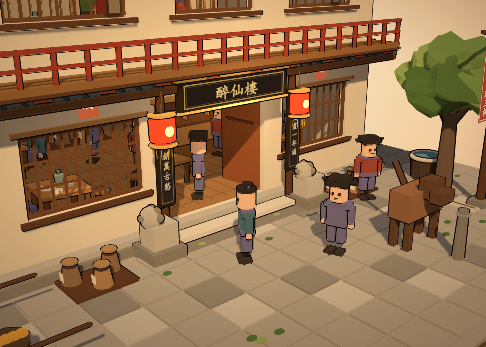

（两张是同一座酒楼、同一个机位，只改了 `figStyle`。）

四条决定成败的规矩：

- **手臂要留真缝**。臂贴着躯干时，同材质合批后反向外壳并成一整块方柱，
  剪影只剩一根棍。躯干收窄到 `0.40`、臂挪到 `±0.30`、中间留 5cm 真空隙，
  再用一道 `0.56` 宽肩线把两臂连回身上，三竖块才读得出来。
- **衣服层次靠色块，不靠面数**。一条深色领口横条 + 一条加粗腰带，
  比堆十个零件有效；店小二靠白巾白围裙、KFC 店员靠红帽白围裙识别。
- **总高锁在 1.70 米**，和旧版人物持平 —— 改人物不改家具、门窗、楼板标高。
  灯会人潮是例外，传 `s*0.58` 维持原来约 1 米的 crowd 身高，
  否则会突然长高七成把桥和灯摊全挡掉。
- **远景严格限材质桶**。城市行人 `face:false` 且只用衣 / 裤 / 肤三桶，
  灯会人潮走 `mono` 单色剪影；二十多个独立动画 `Group` 每多一桶就多二十个 draw call。

寒江雪的蓑笠翁不在这套工厂里 —— 那是刻意不画脸的背影剪影，
「万径人踪灭」要的就是一个人影，换成积木小人反而破了留白。

### 接一份真的 NVIDIA SimReady 资产

NVIDIA 开源库（`simready-foundation` / SimReady Central，CC BY 4.0）里**没有人物网格**，
主要是机器人、仓储、家电与工业设备，`Human 1M` 是动作数据集不是模型。
所以人物始终程序化生成，场景里的**设备类道具**接了三件真资产：电工工作台、烤面包机、咖啡杯。

链路是 `tools/usd2nvr.py`：

1. `usd2toon.convert()` 展开 `geometries.usd`，Z-up → Y-up，拿逐三角顶点；
2. **带颜色的顶点聚类减面**，`4520 / 38594 / 21264 → 1383 / 887 / 630` 三角
   （直接内联原始 USD 会让每个 HTML 多出几 MB）；
3. 几何层只有纯灰 `displayColor`，按三角形重心的相对高度**分段重新染色**成不锈钢 / KFC 红白；
4. 按 `obj2toon.py` 的 NVR 格式把位置量化成 int16、颜色走调色板索引，约 25 字节/三角。

三件合计 74 KB，由 `preset.asset` 在构建时内联，产物仍是单文件离线。
摆放时用 `A.bb` 把资产自己的底面补到目标台面高度 —— NVR 保留原始坐标，底面未必在 0。

## 项目结构


```
build.js            构建器：预设 + 场景模板 + three.js → 单文件 HTML
src/presets.js      二十四个预设：调色板、灯光、相机、天空、文案
src/scene.js        场景生成器（约 17800 行，全部程序化几何，含统一积木人物工厂 buildFig）
src/kfc_assets.js   三件 SimReady 资产的紧凑量化几何（构建时内联）
src/three.min.js    three.js（构建时内联进产物）
tools/usd2nvr.py    OpenUSD → 减面 + 分段染色 → NVR
docs/index.html     在线演示：旗舰城市（构建产物）
docs/kfc.html       在线演示：肯德基得来速店（构建产物）
docs/rainlake.html  在线演示：寒江雪 · 孤舟独钓（构建产物）
docs/lantern.html   在线演示：千灯 · 上元灯会（构建产物）
docs/ruin.html      在线演示：废墟 · 春回（构建产物）
docs/section.html   在线演示：城市剖面（构建产物）
docs/desk.html      在线演示：桌面上的世界（构建产物）
docs/tavern.html    在线演示：醉仙楼 · 三层酒肆（构建产物）
docs/mill.html      在线演示：水车磨坊 · 溪畔（构建产物）
docs/garden.html    在线演示：苏州园林 · 一池三山（构建产物）
docs/tulou.html     在线演示：福建土楼 · 承启楼（构建产物）
docs/lijiang.html   在线演示：丽江古城 · 四方街（构建产物）
tools/              USD / OBJ → 三渲二 的实验脚本（非构建必需）
```

## 已知取舍

- **单个产物约 1.4~1.5 MB**：three.js 占 630 KB，KFC 另带 74 KB 的 SimReady 资产。换来的是「双击就能看、断网也能看」，这个交换在演示场景里是划算的。
- **全量预设有 24 个产物约 35 MB**：所以 `dist/` 不进版本库，`docs/` 只放十五个在线演示。
- **软件渲染下帧率很低**：无 GPU 的截图环境约 3 fps，真机 GPU 上是满帧。
- **旗舰预设机位拉到 232 米**：外环扩到 134×124 后，相机 `far` 提到 1000、雾推到 130~520，否则远处新区会被裁掉。

## 第三方资产与署名

`src/kfc_assets.js` 来自 **NVIDIA/simready-foundation**（CC BY 4.0），
具体三件：`obs_workbench_tool_a01`、`gen_appliance_toaster_v01_01`、`coffee_cup_grasp_a01`。
原始 OpenUSD 几何层经 `tools/usd2nvr.py` 减面、按高度分段重新着色、int16 量化后内联；
贴图、材质图、物理与语义标签均未使用。项目其余几何全部程序化生成，不用任何外部模型或贴图。

## 许可


[MIT](LICENSE) © 2026 Marvelous-dot。可商用、可修改、可分发，保留版权声明即可。
