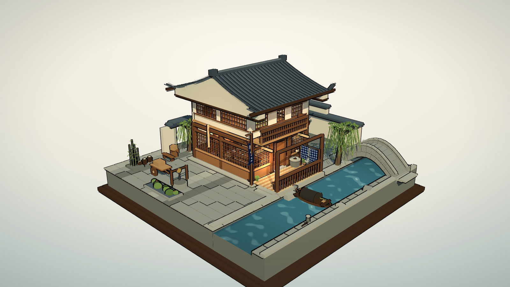
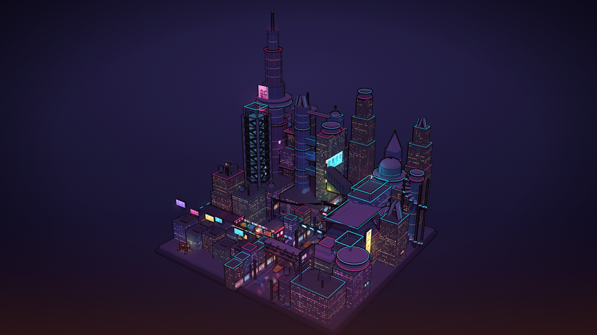
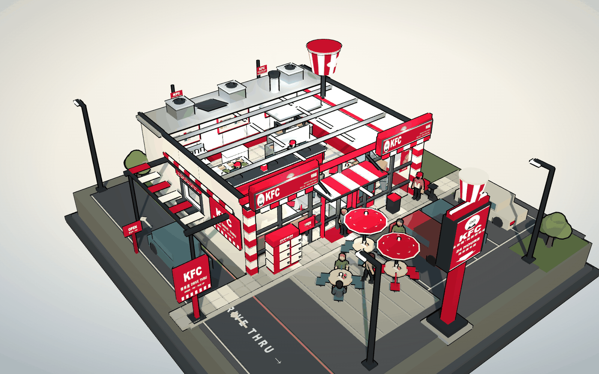
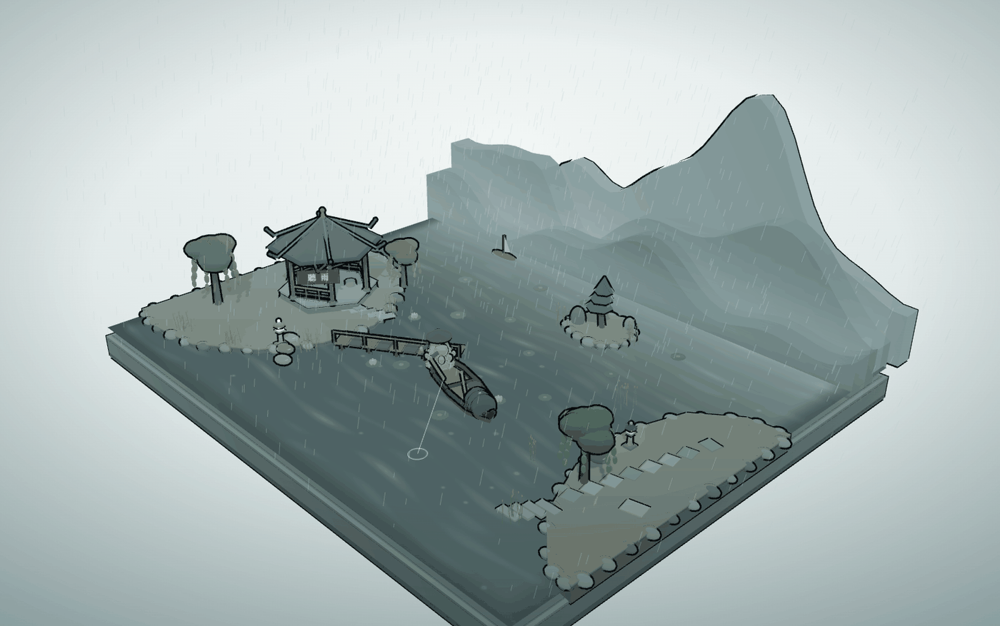
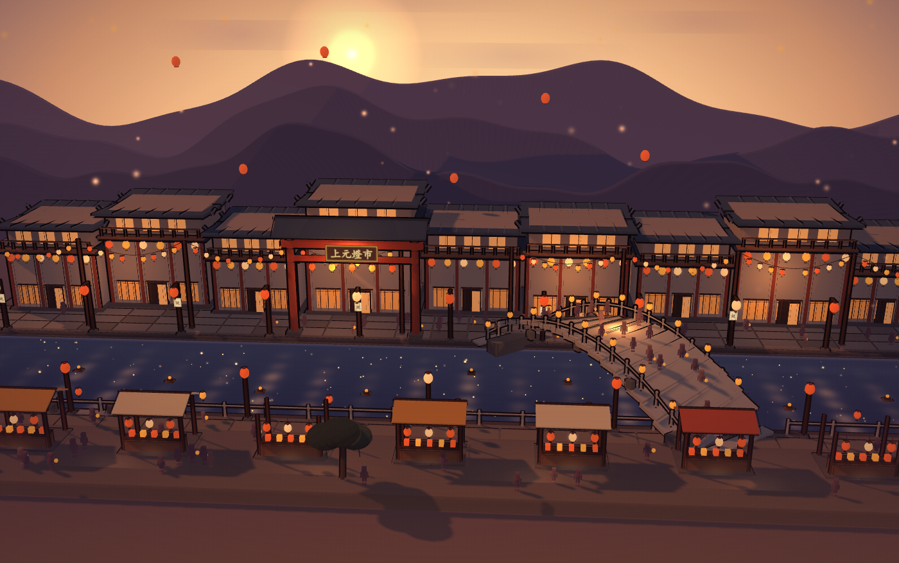
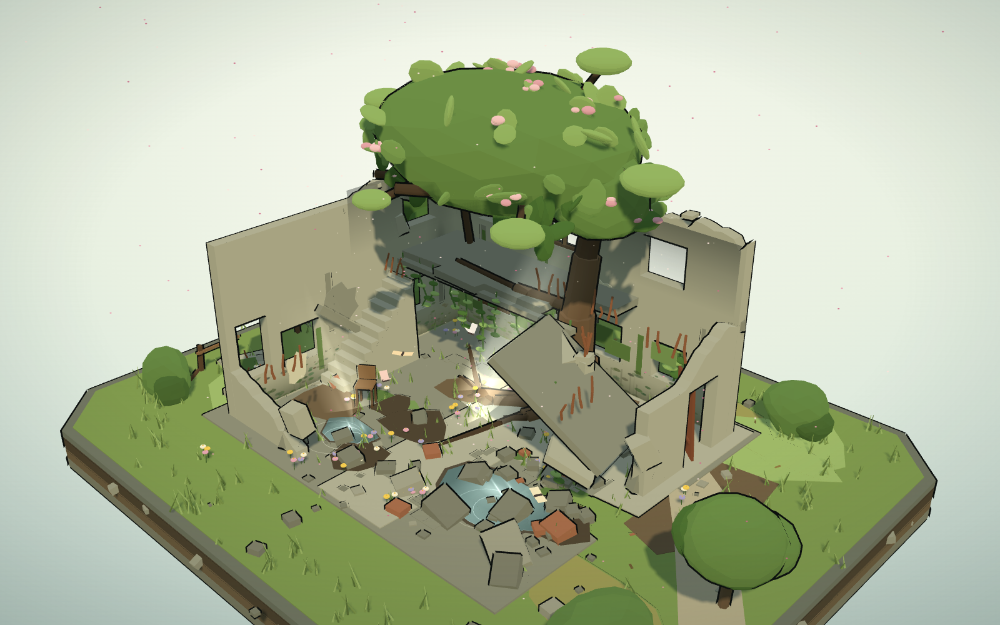
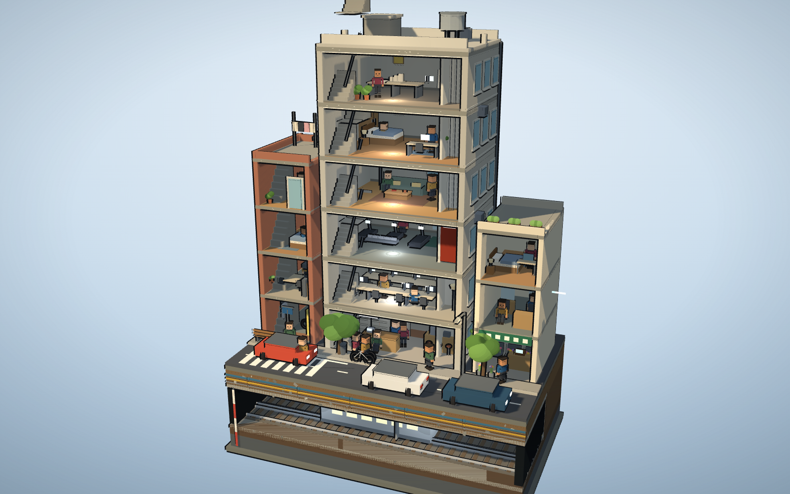
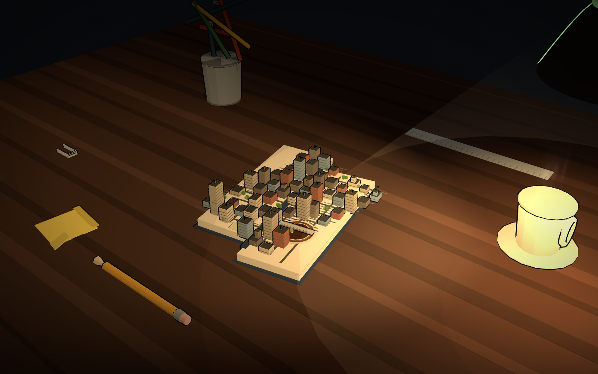
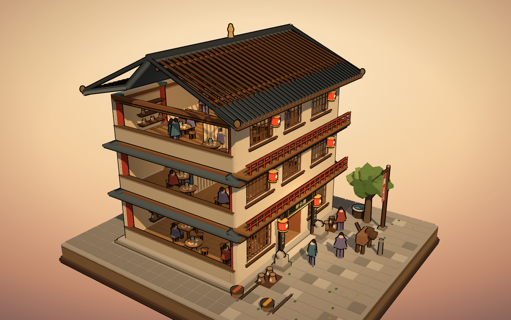

# 城市微缩 · City Diorama

把一座城市做成可以拿在手里转的微缩模型。

纯程序化生成的三渲二（cel-shading）三维场景，**没有一张外部贴图、没有一个外部模型文件** —— 建筑、瓦片、窗、招牌、水面、砖路全部在运行时用代码和 canvas 画出来。构建产物是单个 HTML，双击就能看，不需要服务器、不需要网络。



















## 在线体验

构建产物已放在 `docs/`，开启 GitHub Pages 后可直接在浏览器里拖拽：

> 旗舰城市：`https://marvelous-dot.github.io/city-diorama/`
>
> 肯德基得来速店：`https://marvelous-dot.github.io/city-diorama/kfc.html`
>
> 寒江雪 · 孤舟独钓：`https://marvelous-dot.github.io/city-diorama/rainlake.html`
>
> 千灯 · 上元灯会：`https://marvelous-dot.github.io/city-diorama/lantern.html`
>
> 废墟 · 春回：`https://marvelous-dot.github.io/city-diorama/ruin.html`
>
> 城市剖面：`https://marvelous-dot.github.io/city-diorama/section.html`
>
> 桌面上的世界：`https://marvelous-dot.github.io/city-diorama/desk.html`
>
> 醉仙楼 · 三层酒肆：`https://marvelous-dot.github.io/city-diorama/tavern.html`

## 预设

| id | 名称 | 类型 | 说明 |
|---|---|---|---|
| `city` | 霓虹 · 日本街 | 夜景 / 动态 | 134×124 米的赛博城市：六街区老城 + 外环 L 形水系、六座桥、集装箱港、水上摩天轮、高架单轨 |
| `cyber` | 霓虹 · 日式横丁 | 夜景 | 单条小巷，灯笼与居酒屋 |
| `jiangnan` | 江南 · 临水茶楼 | 日景 | 二层茶楼、拱桥、乌篷船 |
| `huizhou` | 徽州 · 马头墙茶栈 | 日景 | 粉墙黛瓦、马头墙 |
| `chuanxi` | 川西 · 锦江茶铺 | 日景 | 竹椅盖碗、沿街茶摊 |
| `tengwang` | 滕王阁 · 落霞孤鹜 | 日景 | 重檐楼阁与水面倒影 |
| `jiaodong` | 胶东 · 海草房农家院 | 日景 | 厚海草屋顶、石墙院 |
| `store` | 拾光便利 · 午后 | 日景 | 街角便利店，室内可见 |
| `club` | 山海仓 · 会员大卖场 | 日景 | 仓储式卖场的货架纵深 |
| `wh` | 恒仓 · 自动化工厂仓库 | 日景 | 高位货架、输送线、AGV |
| `kfc` | 肯德基 · 得来速店 | 日景 / 室内外 | 剖开屋顶的快餐店：点餐台、后厨炸炉、卡座、儿童区 + 得来速车道、立柱全家桶、户外桌椅；圆润分段人物 + 3 件 NVIDIA SimReady 开源资产 |
| `lantern` | 千灯 · 上元灯会 | 黄昏 / 灯会 / 动态 | 68×42 米暮色河湾：三层靛紫远山与落日、九栋错落临水灯阁、「上元燈市」牌楼、斜跨石拱桥与桥上人潮、近岸九座灯市摊；192 盏花灯辉光呼吸 + 河灯顺流 + 孔明灯升空 |
| `rainlake` | 寒江雪 · 孤舟独钓 | 雪景 / 留白 | 柳宗元《江雪》：116×92 米寒江向雪雾渐隐、四层递远群山、峰顶薄雪、GPU 斜风飘雪、近景一叶孤舟与蓑笠翁 |
| `ruin` | 废墟 · 春回 | 日景 / 叙事 | 20×16 米切开的土台上一栋半塌的两层水泥小屋：断墙、断掉的室内楼梯、烟囱、斜插的楼板；一棵树从二层缺口里长出来，藤蔓垂落、野花与落叶铺满、积水映天光，花瓣与尘埃在光柱里飘 |
| `section` | 城市剖面 | 日景 / 剖面 | 19×12 米地被竖直切开：6 层混合用途楼（便利店 / 联合办公 / 健身 / 公寓 / 卧室 / 工作室）、左邻砖砌四层小楼、右邻三层花店与理发店；切面之下是街道、地下土层层理、管线与一列亮着窗的地铁 |
| `desk` | 桌面上的世界 | 夜景 / 微缩 | 深夜书桌，一盏台灯只照亮一隅：光圈里一本摊开的书，书页上长着一座城——咖啡渍是湖、回形针是环线、笔筒里的笔是摩天楼。全场唯一光源是灯罩里的聚光灯 |
| `tavern` | 醉仙楼 · 三层酒肆 | 黄昏 / 室内外剖切 | 三层酒楼，门窗是真洞口、右山墙整面剖开、屋顶掀掉前坡：一层大堂（柜台/酒坛/八仙桌/店小二）、二层雅座（屏风/圆席）、三层雅阁（书案/博古架/琴案）从门、窗、剖面三个方向都看得见；三层进深前后都铺满席位并各自补光，不留空半层；「醉仙樓」匾额、楹联、酒旗、宫灯、石狮与门前酒坛堆 |

## 快速开始

只需要 Node.js，**没有任何 npm 依赖**（three.js 已内联在 `src/`）。

```bash
node build.js            # 构建全部预设
node build.js city       # 只构建某一个
node build.js city store # 构建指定的几个
```

产物输出到 `dist/`，每个都是独立的单文件 HTML。

## 交互

| 操作 | 效果 |
|---|---|
| 左键拖拽 | 环绕旋转 |
| 滚轮 | 缩放 |
| 右键拖拽 | 平移 |
| 松手静置 | 缓慢自动环绕 |

移动端单指旋转、双指缩放。相机按竖屏做了自适应拉远，手机上不会切掉边角。

## 技术要点

### 三渲二

`MeshToonMaterial` + 自定义 4 段渐变贴图（0.40 / 0.66 / 0.85 / 1.0）压出硬边明暗。

描边不是后期做，是**反向外壳**：同一份几何沿法线外推 `0.0017`，用 `BackSide` 渲染，加进同一个合批里。比后处理描边稳，也不会在细杆件上断线。

### 合批：1585 个 mesh 的城市只有几十个 draw call

所有静态几何都进 `Builder`：`box / cyl / sph / torus / add / xf`，按材质 key 分桶，最后每个桶合并成一个 `BufferGeometry`。

代价是**合并之后动不了** —— 所以天桥上的车、街上的行人必须各自成 `Group`，走独立的动画轨道。这条约束决定了整个场景的组织方式：静态的尽可能合，动态的尽可能少。

### 贴图全部现画

招牌墙、砖墙、窗格、路面、水面波纹都是 `canvas` 画完当贴图用。招牌墙是一张 300×200 的 canvas 画 6 条竖招牌，`RepeatWrapping` 平铺，十几米的招牌密度只花一个 mesh。

远景的假字是随机横竖笔画拼出的「字形」——远处只认黑块与留白的比例，真字反而会因为重复在近景露馅。但**品牌形制必须用真字**：KFC 的招牌、菜单、得来速地面字全用 `canvas` 的 `fillText` 画，否则一眼就认不出是哪家店。

### 发光

`MeshBasicMaterial` + `AdditiveBlending` + `depthWrite: false` + **`fog: false`**。

最后那个 `fog: false` 是关键：夜景有一层紫雾把远景压进背景，但霓虹不能被雾吃掉，否则整个城市会灰掉。

### 天际线：一栋一原型

`ctTower` 只会画方盒加等比例退台，全城共用就会变成一排方形立柱。旗舰预设里并列了八种独立原型（`ctArt*`）：收分八棱塔、外露钢骨架塔、圆柱塔、双塔连体、错层悬挑、镂空门洞、螺旋坡道、楔形斜切；剩下保留方盒的楼再各配一种塔冠（金字塔 / 圆冠 / 飞碟 / 刀片 / 立环 / 针尖 / 开敞框架）。

圆柱与棱柱不能贴四面窗格贴图，改用一圈圈薄发光环加竖棱；环带密度是成败关键，太密就读成一根螺纹管。这些新几何依然全部进 `Builder` 合批，只多出几个材质桶。

### 外环扩展：水面低一层，桥要能透下去

老城 64×60 米，外环铺到 134×124 米，**老城坐标一个不动** —— 等比放大整座城只会变空，正确做法是外围填等量的新内容。

关键的三条几何约束：

- **水面比路面低 1.05 米**：外圈底座顶在 `-1.80`，所有陆地垫到 `y=0`，老城与新区就成了浮在水上的台地，台地侧面天然是驳岸，不用另挖洞。
- **跨水的桥不能有不透明顶板**：第一版在南湖上放了一座玻璃天桥，俯视时它的实心顶板把 18 米宽的水面切成一条紫带，整片水读成棋盘格。改成开敞桁架桥后水才连起来。
- **桥要分高低**：拱桥 0.85 / 太鼓桥 0.7 / 轻轨桥 5.4 / 斜拉桥 1.1 / 桁架桥 2.6 / 浮桥 -0.6，六座同高会叠成一块板。

水面是一张 `canvas` 波纹贴图 + 一张霓虹倒影贴图加色叠上去，几百条细波纹全部合批成一个 mesh。摩天轮的轮圈、列车、驳船各自成 `Group` 才能转 / 才能动。

### 让城市动起来

「有车在跑」的视觉信号不是车的形，是**移动的光** —— 每辆车前面拖一片加色混合的地面光斑，比车本身有效十倍。1.5 米高的行人做腿部动画会让 mesh 数翻倍，收益为零；整体上下浮动加侧倾就足够读成「在走」。

### 剖开屋顶：室内外都要看见

`kfc` 是一套独立形制（`buildKfcSite / Shell / Interior / Props`），不在 `store` 上改。它要解决的是「室内外元素齐全」这个和城市完全不同的问题：

- **屋顶前半剖开、后半保留设备平台**：俯视时点餐台、菜单屏、后厨炸炉、卡座、儿童区全部露出来，同时屋顶的空调外机、排烟管还在，建筑不会读成一个没盖的盒子。
- **任何横跨室内的横条，俯视都会把室内切成条**：第一版沿 x 的红色长檐框、连续招牌带、条纹雨棚把室内切得七零八落。解法是拆段、退到立面外侧、压低高度、改深色细边（`0.14` 米），中间留 4.2 米通透。
- **贴片和背板必须同向**：侧墙招牌贴片 `ry=0` 时宽度沿 x，背板若写成沿 z 铺，就会露出一大块没贴图的纯红板。`kfPlane` 默认单面，相机看不到背面要显式开 `DoubleSide`。
- **地面字要放在雨棚投影之外**：`DRIVE THRU` 被雨棚条板盖住后，把字从 `x=-3.20` 挪到 `x=5.30`，条板从 9 片减到 6 片并加大间隙。
- **立柱招牌别挡自己的字**：顶部旋转全家桶半径从 `0.82` 收到 `0.50`，贴片从 `±0.14` 挪到 `±0.30`、背板加厚到 `0.56`，否则柱子会从牌面中间穿过吃掉一个字母。
- **共享装饰守卫要逐个补 `&& !KFC`**：灯笼、柳树、石灯之类是民居共用的，新形制不排除会飘在快餐店停车场上。

最终 223 个 mesh / 46980 三角，全部材质键在预设里齐备，无缺色告警。


### 寒江雪：主角是空，不是房子

`rainlake` 是第 12 套、也是第一套没有主体建筑的形制。它按柳宗元《江雪》整体重做过一次：
上一版 26×22 米的「江南烟雨盆景」塞了凉亭、栈桥、柳荷石灯，人踪太多、船太小，
读不出「千山鸟飞绝，万径人踪灭」。现在 116×92 米江面向四周渐隐进雪雾、不留托盘边界，
群山四层递远、只有主峰顶着一撮雪，人踪只剩雾里两株枯枝，一叶孤舟是全画面唯一浓墨。

六条实测经验：

- **相机方位角决定构图生死**。`position.x = d·sin(phi)·cos(theta)`，`theta=0` 是站在 +x 侧看，
  横贯 ±66 米的群山会被拧成画面右侧一条斜带、江面变成一整块白板。正对 -z 群山要
  `theta≈1.50`；配 `phi≈1.32` 的近水平俯角，才是「远山横贯上缘 / 寒江占下半 / 孤舟偏左」的立轴三段式。
- **雪帽只能给主峰，不能沿脊线铺带**。连续白带叠三层就是「等高线面条」，被前层山切断后
  还会剩下一片片白色斜胶带。最终做法是扫描局部极大值、要求明显高出两侧，每峰只盖一个纺锤形小雪帽。
- **山脚那条过曝白线是两件事叠出来的**：远岸白色雪坡顶面 + 雪雾片最浓区正好压在 `y≈0`。
  把岸沉到与水面齐平并改暗灰、雾的浓区抬到山脚上方、江面远侧混雾系数压到 `0.26`，硬线才化成山入水。
  画面左侧那片挥之不去的白色斜碎片最后查明是远处小亭的雪顶被雾切剩一角，不是雪帽 —— 删亭即消失。
- **坐姿人物在俯视下就是一坨圆盘**。蓑笠翁不画脸不画肤色，靠「宽斗笠 → 一整片驼背 →
  带稻草束的蓑衣 → 一条垂出船舷的腿 → 一根前伸握竿的手臂」建立剪影；两个对称肩球会变成
  「一张有耳朵的脸」，必须合并成背。人高 / 船长 ≈ 27%，再把船放到近景 `z=+15` 靠透视放大，
  而不是把整条江缩小。蓑衣的稻草束 `z` 要落在锥台表面外侧，贴着中轴画会整根埋进几何里。
- **雪要在 shader 里，不要逐帧对象**。900 片雪存进一个 `T.Points`，
  `mod(aBase - uTime*uSpd, uH)` 循环下落 + 斜风横移，尺寸按 `aSize*860/d` 拉开 5 倍；
  均匀圆点阵会像屏幕噪点，不像风雪。
- **「寒」不是把灯调暗**。主光冷白 `0.88`、半球光 `1.26`、饱和度压到青灰，全画面只留蓑衣一点暖褐；
  不设任何点光，暖光会毁掉寒意。

最终 24 个 mesh / 4880 三角，`magenta:[] / errors:[]`。

### 上元灯会：主角是灯，不是房子

`lantern` 是第 13 套，也是第一套「极闹」的形制。它与 `rainlake` 刻意做成两端：
那边是寒江留白、一点浓墨；这边是 68×42 米河湾里满铺的万点暖光。
暮色远山与落日在天，临水灯街在中，寒河与河灯在下，一座斜跨石拱桥把两岸连起来。

六条实测经验：

- **灯火不能靠点光**。192 盏实体灯笼全部登记到 `LN_LAMPS`，交给一个 `T.Points`
  统一画辉光与呼吸；全场景只留 6 盏暖 `PointLight`。点光一多，黄昏的暗部被抬平，「夜」就没了。
- **三类粒子各一个 draw call**：花灯辉光（原地呼吸）、河灯（vertex shader 里
  `mod(p.x + uTime*aSpd + 34, 68) - 34` 顺流回卷）、孔明灯（`mod(p.y + uTime*aSpd, 28)` 循环上升）。
  实测三个 Points 的 `uTime` 同步推进，两帧之间约 31% 像素在变。
- **正面机位会把沿视线的桥压成一条竖线**。桥沿 z 跨河、相机又正对 -z，
  于是十几个栏杆灯柱排成一串「插在水里的柱子」。解法不是换机位（斜机位会在画面角上
  露出展台之外的背景空白），而是让桥轴线在 x 上斜移 10 米，每段桥面同步传 `ry = atan2(dx, dz)`。
  拱券立柱、栏杆、人潮的横向偏移都要按 `cos(ry)/sin(ry)` 分解，否则整根飘到桥外水面上。
- **人潮用光点，不用脸**。剪影第一版是「锥台太粗 + 球头太大」，远看一排黑色保龄球瓶。
  收窄躯干、补一道肩线、缩小头，每三到五个人配一盏提灯，人才被读到。
- **近岸不能留空**。第一版近岸是 12 米深的素褐色空地，占掉画面下三分之一，
  灯街再热闹也救不回来。改成九座灯市摊子 + 石栏 + 看灯人潮 + 地面暖光片，下半屏才立住。
- **远山板两端会露出直角纸片边**。采样范围从 ±40 扩到 ±72 让端部出画，
  山脚统一沉到 `y=-6` 交给暮雾吃掉、只留脊线，纸片感立刻消失。

最终 179 个 mesh / 154944 三角，`magenta:[] / errors:[]`。

### 废墟回春：主角是「没人之后」

`ruin` 是第 14 套，也是唯一一套**叙事在时间轴上**的形制：房子已经塌了很久，
春天是后来才来的。所以画面里必须同时读出「人走了」和「一直在长」这两件事。

七条实测经验，其中前两条是这一套最贵的两课：

- **整面墙不能拿几十个小盒子拼**。第一版墙是「一块块砖垒上去」，每块盒子都自带一圈反向外壳描边，
  远看整面墙爬满规则砖缝，像贴了马赛克。**一面墙必须是一个带洞口的挤出多边形**
  （`T.Shape` + `sh.holes.push(new T.Path())`），窗洞是真的洞，墙才是一整块。
- **断墙的顶边要「控制点 + 线性插值」**。每个采样点各自独立抖动，会得到一排锯齿 —— 城墙垛口。
  正确做法是每 0.92 米放一个控制点、点间插值、只叠一点小噪声，个别点偶尔掉一块。
  顺带一条：洞口上沿必须 `Math.max(topAt, holeTop + 0.14)`，否则洞会从断口轮廓里破出去。
- **树冠不能是「一堆球」**。toon 材质给每个球描一圈黑边，几十个球叠起来就是一堆绿球。
  改成「4 个噪声位移球体做体积（轮廓只有 4 圈）+ 表面撒扁平叶簇打碎明暗」，
  叶体用 `IcosahedronGeometry(1, 2)` 的刻面 —— 刻面够大，四个色阶才被切成块，不然是一整片平绿。
  叶簇的法线要沿球面走并带随机倾角：全部水平摆放，俯视下就是一片贴上去的荷叶。
- **墙如果整面一个亮度，开多少窗都还是光板**。室内真正缺的是明暗关系，
  补两张带 alpha 的竖直渐变黑片（越靠楼板越暗）+ 楼板下的一道软投影 + 墙角一片暗，
  比再加一百个盒子有效。**遮罩片必须完全落在墙体轮廓内**，否则会从矮下去的断口上方露出来，变成浮在天上的灰板。
- **楼梯要整段挤出，不能一级一个 box**；而且 `rotateY(-π/2)` 之后挤出方向落在 `-x`，
  只平移一个墙厚会整段跑到墙外面去 —— 第一版楼梯就是这么消失的。
- **这个俯角下远景山落不进画面**。26 米展台、33° 俯角，山放在 90 米外时角位置已经高过画面上缘，
  只在右上角露出一条楔形边。删掉山，改成**展台侧面做土层剖面**：混凝土薄边 → 表土 → 心土 → 碎石层，
  四层颜色不同，模型才不是一块浮在空中的贴纸。
- **墙根不能直接切到草地**。一条从地面爬上来的潮气带（canvas 画的苔藓团 + 竖向流痕，
  只铺在窗台以下，避免糊住窗洞）压住墙与地的硬交线；地面再补裂缝、泥斑、落叶、碎石，
  一片均匀的灰地坪比没有地坪更假。

最终 105 个 mesh / 137113 三角，`magenta:[] / errors:[]`。

### 城市剖面：切一刀，把六种生活并排摊开

`section` 是第 15 套。前面十四套都在做「一栋建筑」，这一套做的是「一段城市」：
一块地被竖直切下来，切面上从上往下依次是屋顶、六层楼、街道、土层层理、地铁。

七条实测经验：

- **剖面里只有「前 4 米」看得见**。楼板会挡住视线：往房间里看 f 米深，能看到的墙面高度是
  `层高 - 深度 × tan(俯角)`。层高 3.2、俯角 19° 时，后墙 1.8 米以上全被楼板切掉。
  **家具必须靠切面摆**——第一版把所有柜子贴后墙，结果六个房间全空。
- **一栋楼只是「楼剖面」，两栋才是「城市剖面」**。左侧补了一栋砖砌四层小楼、右侧一栋三层花店，
  三栋高度错开、切面深浅错开（0.10 / 0.40 / 0.30），画面才有一个街区的进深。
- **一街三色**。三栋楼如果都用同一种混凝土，最先垮掉的是「城市」这件事：
  主楼冷灰 `scCon`、左楼旧砖 `scBrickW2`、右店米白 `scCream`。
- **隧道的近侧壁必须落在切面上**。隧道沿 x 穿过地块，如果按常规定位，切面在它外面 0.55 米，
  俯视下只能看到一条土带。把近壁设成 `T_ZF = SC_ZH`，剖切面直接切进隧道内部，
  远壁、双轨、列车侧面才一起露出来。土方也要**绕开隧道分块挤出**（canyon 只有远侧那一截）。
- **地下的层理要四层不同色**：沥青 / 表土 / 心土 / 碎石层，每层挤出一次。
  土里的石子只长在切面上（`z = SC_ZH - 0.008`），埋在内部的看不见也白花三角。
- **侧墙不开窗就是一块水泥板**。外立面用「贴面凹窗」：深色玻璃 + 四道浅色窗框 + 一块窗台，
  比真切洞便宜得多，远看一样是窗；再配空调外机与落水管，立面才有生活痕迹。
- **每层一盏室内点光，但别让它在地板上留下一个圆斑**。点光离地 2.2 米、`distance 5.2` 时，
  圆形光斑会明明白白画在地上；改成贴顶棚 0.3 米、`distance 7.4`、强度降到 4.6，才只剩一层柔光。

最终 233 个 mesh / 84240 三角，`magenta:[] / errors:[]`。

### 桌面上的世界：一盏灯，一座城

`desk` 是第 16 套，也是唯一一套「以厘米为单位」的形制：桌面 2.0×1.4 米，
杯子 8.5 厘米，城里最高的一栋 3.5 厘米。整幅画面只有一盏台灯亮着。

六条实测经验：

- **光只有一个来源，光圈之外不是「暗」，是黑**。全场只有灯罩里的一盏 `SpotLight`
  （`angle 0.68 / penumbra 0.72`），面光压到 0.16 只用来勾轮廓。
  想靠「加个半球光把暗部提亮」的念头一冒出来，夜景就没了。
- **聚光灯要对准书，不是对准杯子**。第一版目标点随手给了杯子，结果城市整片在暗处、
  杯子过曝成一团白。主角在哪，光就在哪。
- **纸和瓷都是浅色，一过曝就全糊**。`intensity 1.45 / decay 1.55` 才让楼有体积；
  材质也要主动压暗（纸 `0xd9d0ba`、杯 `0xc8c1b0`），别指望灯光帮你收。
- **灯罩不能用几个圆柱叠出弧度**。每段圆柱各带一圈描边，三段叠起来就是三层绿饼；
  改用一条 `LatheGeometry` 车削轮廓，一个网格、一圈边。
- **城市不要手写坐标去「摆」**。第一版列了 24 个坐标，摆出来是散的。
  改成**先定格子、楼往格子里坐**：格子决定街，空格就是广场和公园，湖就是挖掉的几格。
  再叠高度方差（`0.009 + pow(r,3.1)*0.034`、市中心 ×1.45、偶尔 ×1.9），才有天际线。
- **湖一定要放在「前排没有楼」的位置**。咖啡渍本来在城北，从机位看过去被自己城里的房子
  挡得一点不剩；挪到城南的空格处、外圈加一道浅色岸线，那片渍才读成水。

最终 111 个 mesh / 21881 三角，`magenta:[] / errors:[]`。

### 醉仙楼：三条「看得见里面」的通道

`tavern` 是第 17 套，也是第一套要求**门窗必须真透视**的形制。只把屋顶掀开不够，
从斜上方看，楼板会把每一层的室内挡掉大半。所以同时开了三条通道：

- **真洞口**：三层正面墙各是一整块带洞的 `ExtrudeGeometry`（门一、窗三），
  洞口里只放稀疏竖棂 + 两道横档，**不糊窗纸、不贴发光亮板**——
  贴一块亮板就等于把窗封死。家具全部摆在窗后 1.7 米内，视线一进来就撞得到。
- **整面剖开**：右山墙（`+Z`）只留 0.82 米槛墙与柱梁，三层室内从侧面一览无余；
  每层靠剖口再补一席桌椅，否则最上层会空。
- **掀掉前坡**：屋顶只留后坡 + 前檐一小截，露空区补椽子、两道檩和一条深色断面木条，
  读成「被剖开的屋顶」而不是一个三角黑洞。

三个反复踩到的坑：

- **匾额会被自己的腰檐吃掉**。牌面原本贴在外墙 `F+0.30`，而腰檐外沿在 `F+0.62`
  且高度正好压在匾额上；挑到 `F+0.72`（檐外）才看得见。楹联同理，别贴在柱子后面。
- **两扇门必须朝室内开，且旋转角相反**。左铰链门扇往 `+z` 伸、右铰链往 `-z` 伸，
  写成同号会两块板一起斜插到门前，把门洞糊死。
- **门轴正后方不能是空的**。门洞敞开却只看到一块地板，比关着门还空；
  正对门摆一桌一凳一个店小二，门里立刻「有内容」。地板还要铺板缝，
  否则斜视角下会读成一块斜坡。
- **★ 家具别只摆靠门窗的一半**。进深 8.8 米，第一版把所有桌椅都压在
  `x > -2.4` 的前半（为了「窗后 1.7 米内先撞到家具」），结果从剖口看进去，
  后半 3.5 米是一整片空地板 —— 每层「只有一半有内容」。
  修法是给后半单独写一个 `tvBackHall()`：每层两席（一席贴剖口侧 `z > 2.5`
  保证第一眼看得见）、一件面朝剖口的屏风当竖向背景、人物错开朝向；
  并且**每层再补两盏后堂点光**（`x ≈ -4.05 / -3.55`，衰减距离压到 5.4–6.0
  免得串层），否则补完家具也是黑的。默认机位也要从 `theta 0.72` 转到
  `0.95`，让剖口正对观众，三层室内一眼看全。

室内每层四盏低强度暖点光（前半两盏 + 后堂两盏）+ 自发光背板提亮，
室外黄昏斜光与相机同侧，正面门窗不逆光。
定稿 188 mesh / 137040 三角，`magenta:[] / errors:[]`。

### 人物：分段四肢比堆面数管用

旧版人物是「方盒身 + 球头 + 头顶一块方板」，近景像积木。问题不在面数，在**剪影**：
没脖子、没腰、手臂贴身、腿是两根方柱。`kfPed` 现在用锥台做上宽下窄的躯干、
两点连线圆柱做上下臂与大小腿、球做肩/髋/头/手、扁盒做鞋，再叠发型、五官、
店员围裙与红帽、顾客手提袋；支持 `stand / walk / sit` 三种姿势与 3 种肤色、4 种发色。

两个实测细节：

- **顶发必须偏后**。盖到 `z=+0.12` 就把眼睛糊掉，脸等于白做。
- **坐姿不能放在有遮阳伞的圆桌**：伞沿 `1.02 m` > 椅距 `0.86 m`，上半身会被整片切掉。

城市行人只做轻量剪影升级（锥台躯干 + 分腿 + 圆肩），材质严格保持 3 桶，
否则 22 个独立动画 `Group` 的 draw call 会翻倍 —— 远景里细节本来就读不出来。

### 接一份真的 NVIDIA SimReady 资产

NVIDIA 开源库（`simready-foundation` / SimReady Central，CC BY 4.0）里**没有人物网格**，
主要是机器人、仓储、家电与工业设备，`Human 1M` 是动作数据集不是模型。
所以人物走程序化精修，场景里的**设备类道具**接了三件真资产：电工工作台、烤面包机、咖啡杯。

链路是 `tools/usd2nvr.py`：

1. `usd2toon.convert()` 展开 `geometries.usd`，Z-up → Y-up，拿逐三角顶点；
2. **带颜色的顶点聚类减面**，`4520 / 38594 / 21264 → 1383 / 887 / 630` 三角
   （直接内联原始 USD 会让每个 HTML 多出几 MB）；
3. 几何层只有纯灰 `displayColor`，按三角形重心的相对高度**分段重新染色**成不锈钢 / KFC 红白；
4. 按 `obj2toon.py` 的 NVR 格式把位置量化成 int16、颜色走调色板索引，约 25 字节/三角。

三件合计 74 KB，由 `preset.asset` 在构建时内联，产物仍是单文件离线。
摆放时用 `A.bb` 把资产自己的底面补到目标台面高度 —— NVR 保留原始坐标，底面未必在 0。

## 项目结构


```
build.js            构建器：预设 + 场景模板 + three.js → 单文件 HTML
src/presets.js      十七个预设：调色板、灯光、相机、天空、文案
src/scene.js        场景生成器（约 16000 行，全部程序化几何）
src/kfc_assets.js   三件 SimReady 资产的紧凑量化几何（构建时内联）
src/three.min.js    three.js（构建时内联进产物）
tools/usd2nvr.py    OpenUSD → 减面 + 分段染色 → NVR
docs/index.html     在线演示：旗舰城市（构建产物）
docs/kfc.html       在线演示：肯德基得来速店（构建产物）
docs/rainlake.html  在线演示：寒江雪 · 孤舟独钓（构建产物）
docs/lantern.html   在线演示：千灯 · 上元灯会（构建产物）
docs/ruin.html      在线演示：废墟 · 春回（构建产物）
docs/section.html   在线演示：城市剖面（构建产物）
docs/desk.html      在线演示：桌面上的世界（构建产物）
tools/              USD / OBJ → 三渲二 的实验脚本（非构建必需）
```

## 已知取舍

- **单个产物约 1.1~1.2 MB**：three.js 占 630 KB，KFC 另带 74 KB 的 SimReady 资产。换来的是「双击就能看、断网也能看」，这个交换在演示场景里是划算的。
- **全量预设有 17 个产物约 21 MB**：所以 `dist/` 不进版本库，`docs/` 只放八个在线演示。
- **软件渲染下帧率很低**：无 GPU 的截图环境约 3 fps，真机 GPU 上是满帧。
- **旗舰预设机位拉到 232 米**：外环扩到 134×124 后，相机 `far` 提到 1000、雾推到 130~520，否则远处新区会被裁掉。

## 第三方资产与署名

`src/kfc_assets.js` 来自 **NVIDIA/simready-foundation**（CC BY 4.0），
具体三件：`obs_workbench_tool_a01`、`gen_appliance_toaster_v01_01`、`coffee_cup_grasp_a01`。
原始 OpenUSD 几何层经 `tools/usd2nvr.py` 减面、按高度分段重新着色、int16 量化后内联；
贴图、材质图、物理与语义标签均未使用。项目其余几何全部程序化生成，不用任何外部模型或贴图。

## 许可


[MIT](LICENSE) © 2026 Marvelous-dot。可商用、可修改、可分发，保留版权声明即可。
